# DocMate Customer Portal — Reviewer User Manual

**For:** Customer reviewers (QC agents)

This manual explains how to review records in the DocMate Customer Portal. It follows a working session from start to finish: signing in, working through your queue, checking each record against its image, recording your verdict, and signing out.

The examples use a fictitious customer, **Acme Archive Corp**, and its reviewer **Priya Raman**. Acme's supervisor is **Dana Whitfield**. Your own organisation, projects and colleagues will appear in their place.

> **How to read the pictures.** A **red outline** marks the button or area to click in that step.

> **What's new since version 0.9.0**
> - **Say what was wrong with each defective field:** **Missing**, **Typo** or **Interpretation**. DocMate uses your answer to class the defect as critical, major or minor, and **Submit Review** stays greyed out until every defective field has one ([Section 7](#7-reviewing-field-by-field-iso-projects)).
> - Fields that identify the record are tagged **Identifier** (they used to be tagged **Critical**). Any error in them is a critical defect.
> - DocMate counts only the time you actually spend working on a record. Time away from it isn't counted ([Section 9](#9-leaving-a-review-and-coming-back-to-it)).
> - **Help in the portal.** This manual and the reviewer workbook open from **Help** in the menu, and you can download a PDF copy ([Section 3](#getting-help-in-the-portal)).
> - **A new look.** The portal and its sign-in page carry the DocMate logo and colours.

---

## Contents

1. [Your role](#1-your-role)
2. [Signing in](#2-signing-in)
3. [Finding your way around](#3-finding-your-way-around)
4. [Your QC task queue](#4-your-qc-task-queue)
5. [Starting a review](#5-starting-a-review)
6. [The review screen](#6-the-review-screen)
7. [Reviewing field by field (ISO projects)](#7-reviewing-field-by-field-iso-projects)
8. [Passing or rejecting a record (manual-rate projects)](#8-passing-or-rejecting-a-record-manual-rate-projects)
9. [Leaving a review and coming back to it](#9-leaving-a-review-and-coming-back-to-it)
10. [Good reviewing practice](#10-good-reviewing-practice)
11. [Signing out](#11-signing-out)
12. [Troubleshooting](#12-troubleshooting)
13. [Glossary](#13-glossary)

---

## 1. Your role

A digitization team indexes your organisation's records: they type the information on each card or page into DocMate. Each record ends up with:
- its **image**, the scan of the original;
- its **indexed data**, what the team typed.

The team hands its work over in **lots**. Your supervisor picks a random **sample** from each lot and assigns those records to reviewers like you.

**Your job is to compare each sampled record's indexed data with its image, and say whether it was entered correctly.** Your verdicts decide whether the whole lot is accepted or sent back to the team for correction. So one careful review matters for many records.

You see only the **QC Workspace**, which lists the records assigned to you. Lots, reports and project figures are managed by your supervisor.

---

## 2. Signing in

Your DocMate administrator gives you two things:
- **Your organisation's portal address.** For Acme it is `https://acme-archive.docmate.local`.
- **Your username and password.** Your username is your email address.

**Step 1.** Open your portal address in a web browser. Chrome, Edge, Firefox and Safari all work. The page shows **"Connecting…"** for a moment, then your organisation's sign-in page appears: the DocMate logo, with your organisation's name under it.

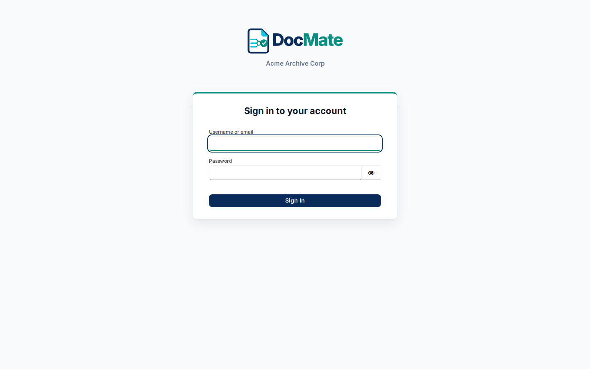

**Step 2.** Enter your email address and password, then click **Sign In**.

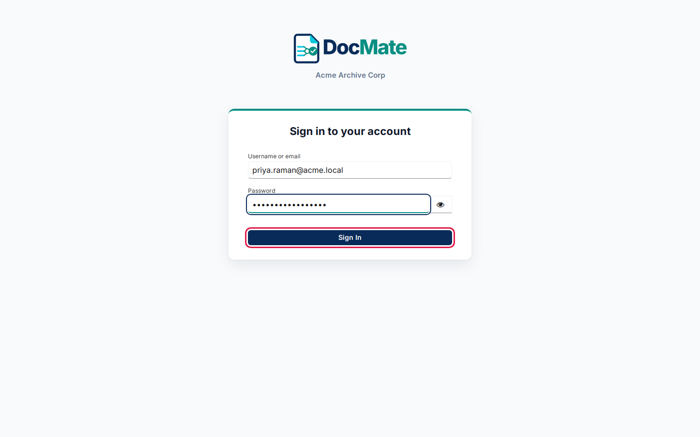

**Step 3 (first sign-in only).** The password you were given is temporary, so you're asked to choose your own. The page says *"You need to change your password to activate your account."*

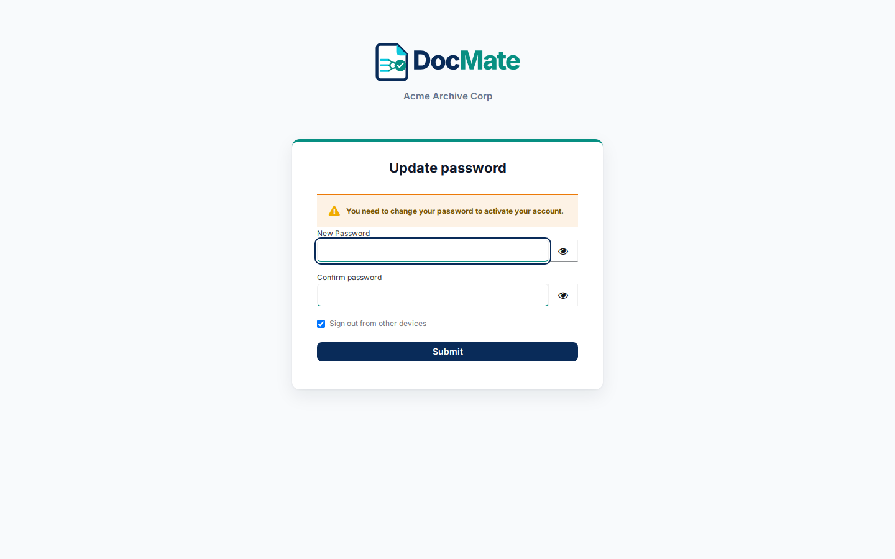

Type a new password in **New Password** and again in **Confirm password**, then click **Submit**.

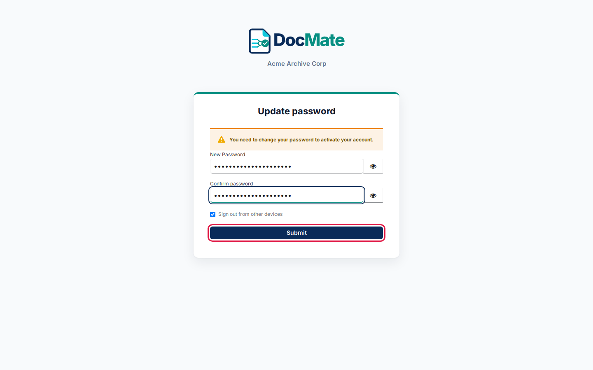

**Step 4.** The portal opens on your **QC Task Queue** ([Section 4](#4-your-qc-task-queue)).

From now on, sign in with your email address and your new password. If you forget it, ask your supervisor or administrator to reset it.

**Staying signed in.** DocMate keeps you signed in while you're working: clicking, typing, scrolling and zooming all count. After about half an hour without any activity, you'll be asked to sign in again.

---

## 3. Finding your way around

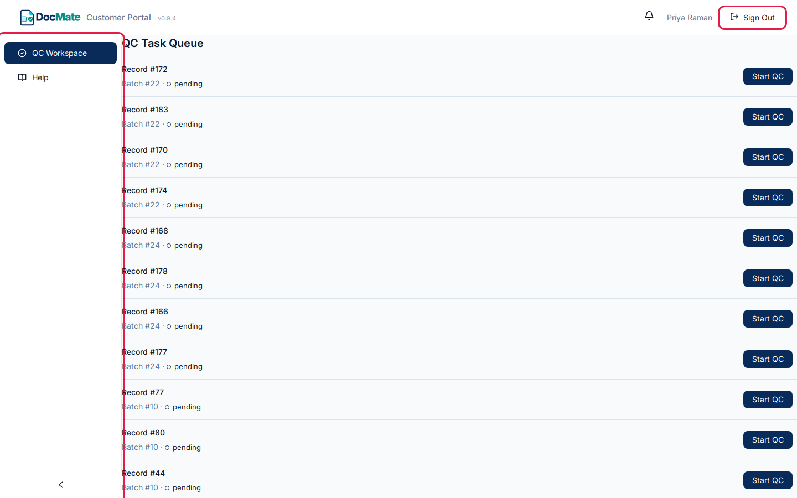

- **The menu (left)** has two items: **QC Workspace**, where you do your reviews, and **Help** (see below). The arrow at the bottom collapses the menu. On a phone or narrow window, the menu is behind the **☰** button at the top left.
- **The header (top)** shows the DocMate logo and version, the notifications bell, your name and **Sign Out**.

### Getting help in the portal

**Help** in the menu opens the DocMate manuals inside the portal. You see the ones for your role: as a reviewer, this manual and the *Reviewer Training Workbook*.

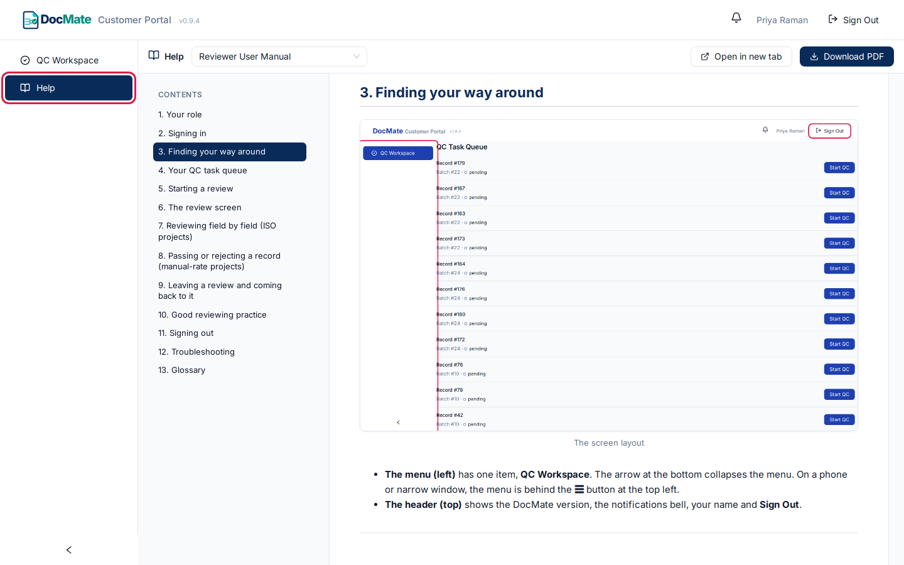

- **Choose a manual** in the box at the top. The contents list on the left jumps to any section.
- **Open in new tab** shows the manual in its own browser tab, which is handy beside the screen you're working on.
- **Download PDF** saves a copy to print or read offline. The PDF is prepared for your organisation: its name is on the cover and at the foot of every page. Keep these copies within your organisation.

The manuals always match the version of DocMate you're using.

---

## 4. Your QC task queue

The **QC Task Queue** lists every record assigned to you, across all your organisation's projects.

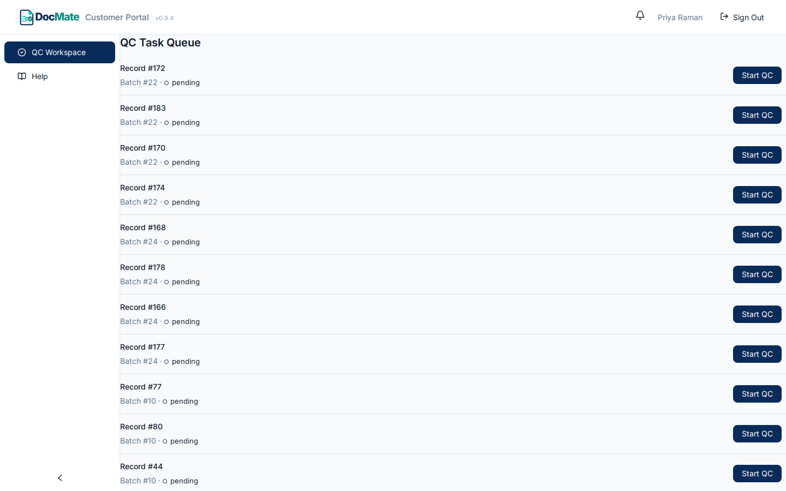

Each entry shows:
- **Record #:** the record's number. Quote it if you need to ask your supervisor about a record.
- **Batch #:** the batch of work it belongs to. Your supervisor may assign you several batches, from different lots or projects.
- **Status:** **pending** (not started) or **in_progress** (started but not finished).

It also has a button:
- **Start QC** begins reviewing a pending record.
- **Resume** returns to one you have started.

The queue refreshes itself every 30 seconds. New assignments appear without you doing anything. When the queue is empty it shows *"No QC tasks assigned to you"*: you're up to date.

> You can take records in any order. Working from the top down makes it easy to see what's left.

---

## 5. Starting a review

**Step 1.** Click **Start QC** next to the record.

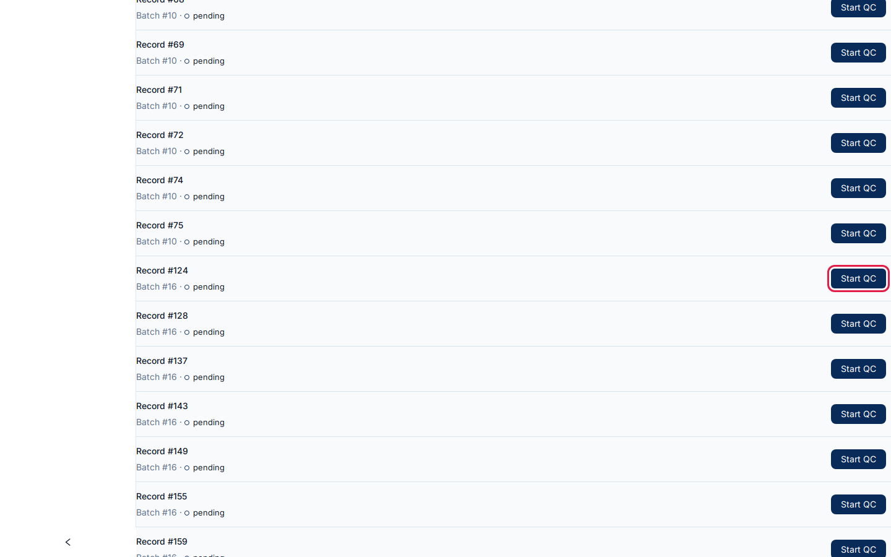

**Step 2.** The review screen opens ([Section 6](#6-the-review-screen)). Starting a review **locks** the record to you, so nobody else can review it at the same time. A blue banner confirms: *"Record locked by you for QC review."*

The lock is released when you submit your verdict. If you leave without submitting, the record stays locked to you until you come back ([Section 9](#9-leaving-a-review-and-coming-back-to-it)).

---

## 6. The review screen

The screen is split in two:
- **left:** the record's **image**;
- **right:** its **indexed data** and your **review controls**.

Drag the bar between the two halves to make either side bigger.

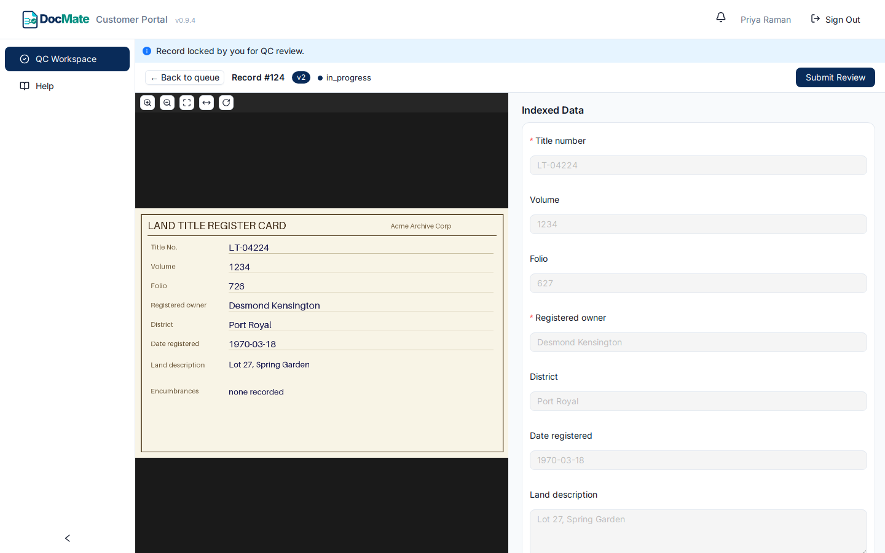

**The bar across the top** shows:
- **← Back to queue**;
- the record's number and version (for example **v2**);
- its status;
- on the right, the button that records your verdict: **Submit Review**, or **Pass** and **Reject** ([Sections 7](#7-reviewing-field-by-field-iso-projects) and [8](#8-passing-or-rejecting-a-record-manual-rate-projects)).

**Banners** above the bar:
- **Blue:** *"Record locked by you for QC review."* The record is yours to review.
- **Red:** *"Record locked by user ID … Please contact your supervisor."* Someone else has the record open. Don't review it; tell your supervisor.
- **Yellow:** *"This record was rejected before and has been corrected — this is version …"* Only records that were sent back and fixed show this. Check that the earlier problem really has been corrected.

### Working with the image

| To… | Do this |
|---|---|
| Zoom in or out | Scroll the mouse wheel over the image, or use the **Zoom In** / **Zoom Out** buttons |
| Move around a zoomed image | Click and drag the image |
| Show the whole page | **Fit Page** |
| Fill the width of the pane | **Fit Width** |
| Turn a sideways scan upright | **Rotate** (each click turns it 90°) |
| Move between pages of a multi-page record | **Previous Page** / **Next Page**. These buttons appear only for multi-page records. |

Zoom in close to check small or faint handwriting before deciding.

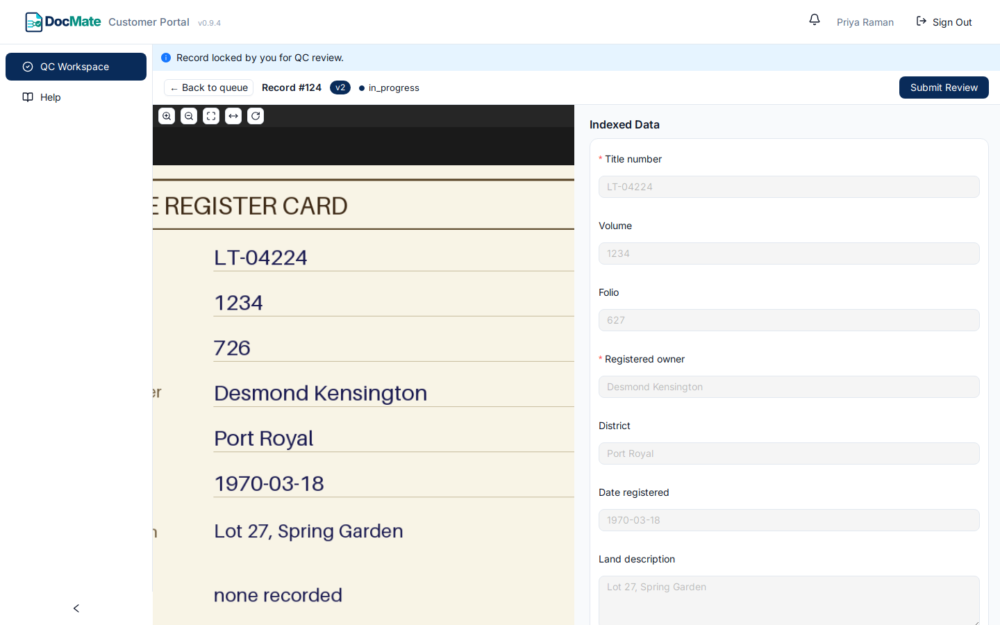

### The indexed data

The right-hand side shows every field the team entered, laid out like the form they used. A red **\*** marks a required field. You can't change the data here. Your job is to judge it, not correct it: if something is wrong, the record goes back to the team to fix.

---

## 7. Reviewing field by field (ISO projects)

Most projects use **ISO 2859‑1** sampling. On these, you judge **each field** separately in the **Field Review** card, below the indexed data. You'll know a project uses ISO sampling because the button at the top right is **Submit Review**.

**Step 1.** Scroll the right-hand side down to **Field Review**. Every field starts as **Accepted**, so you only need to change the ones that are wrong.

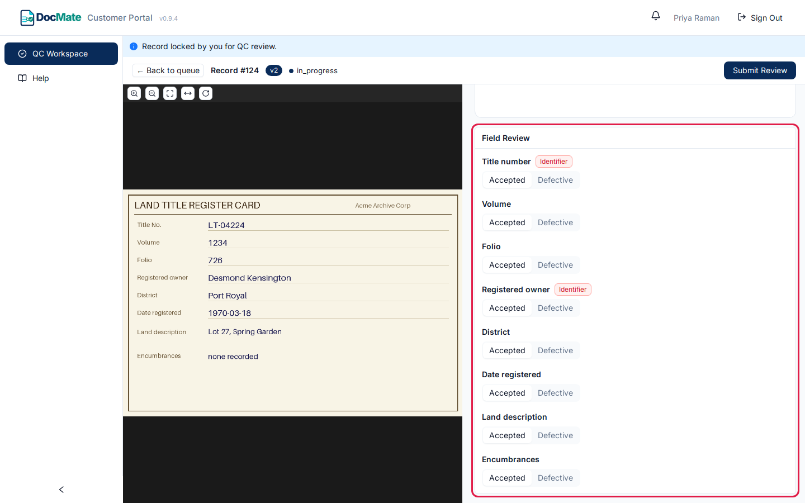

Fields with a red **Identifier** tag identify the record. In the example, these are *Title number* and *Registered owner*. Any error in an identifier field is a **critical** defect, and a single critical defect usually fails the whole lot, so check those fields with particular care.

**Step 2.** Compare each field with the image. Where a field doesn't match the card, click **Defective** for that field. Three buttons and a note box appear, and the words *"Choose what is wrong"* remind you to pick one of the buttons.

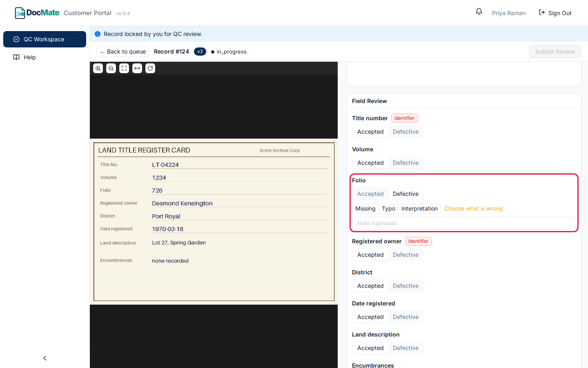

**Step 3.** Click the button that describes the error. Hover over a button for a reminder of what it means.

| Button | Use it when… | Example |
|---|---|---|
| **Missing** | A value on the image was left out | The card shows a caveat under *Encumbrances*, but none was entered |
| **Typo** | The value was typed wrongly: wrong, extra or swapped characters | Folio **726** entered as **627** |
| **Interpretation** | The source was read or understood wrongly | A district name misread as a different district |

A tag beside the buttons shows the defect's class: **Critical**, **Major** or **Minor**. You don't choose the class: it follows from what you picked and from whether the field is an identifier. If you mark an empty field as defective, **Missing** is chosen for you; change it if something else was wrong.

**Step 4.** In the note box, say briefly what's wrong. The note is optional, but it helps the team fix the record quickly.

In the example, the card shows folio **726** but **627** was entered. Priya marks **Folio** as defective, chooses **Typo** (a **Minor** defect on this project), and writes *"Folio on the card is 726; entered as 627"*.

**Step 5.** Click **Submit Review**. It stays greyed out until you've chosen what was wrong with every defective field.

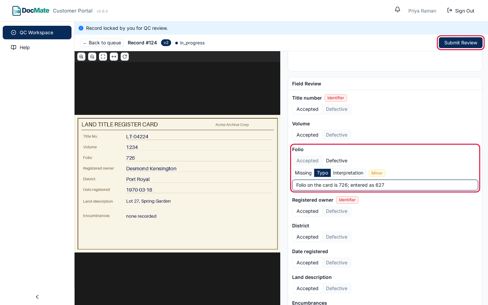

**Step 6.** A message, **"QC review submitted"**, confirms it, and you're returned to your queue.

What your verdict does:
- **Any field marked Defective:** the record is **rejected** and goes back to the digitization team for correction, with your notes.
- **All fields Accepted:** the record **passes**.

### When everything is correct

If every field matches the image, leave them all as **Accepted** and click **Submit Review**.

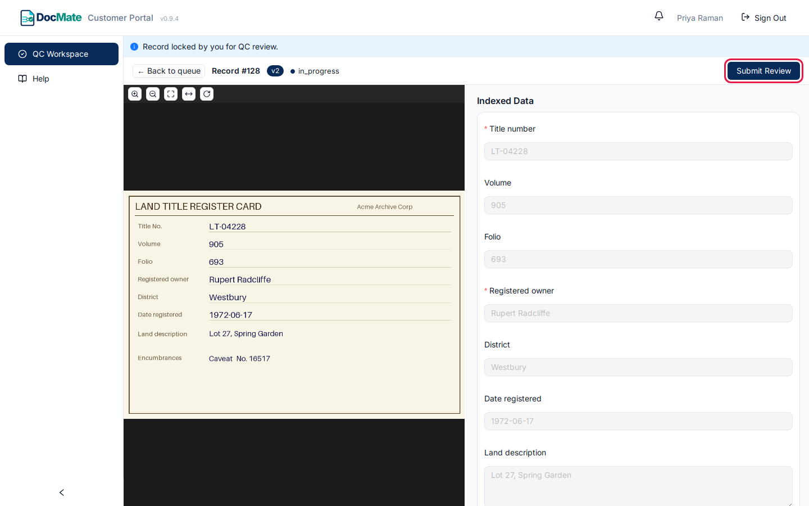

> **What counts as defective?** Anything that doesn't faithfully match the image:
> - a field left empty although the card shows a value, or an item missing from a list (**Missing**);
> - a wrong, missing or extra character, a transposed number or a misspelt name (**Typo**);
> - a value read or understood wrongly, or put in the wrong field (**Interpretation**).
>
> Your supervisor will tell you about any project-specific rules, for example how to treat illegible text.

---

## 8. Passing or rejecting a record (manual-rate projects)

Some projects use simple pass/reject review. You'll know because the buttons at the top right are **Pass** and **Reject**, and there's no Field Review card.

### To pass a record

Check every field against the image. If everything matches, click **Pass**. A message, **"Record passed QC"**, confirms it, and you're returned to your queue.

### To reject a record

**Step 1.** Click **Reject**.

**Step 2.** Type the **Rejection reason**. It's required: say exactly what's wrong, so the team can fix it without guessing. In the example: *"Executor on the card is Lorna Kensington, entered as Henry Fairbanks."*

**Step 3.** Click **Confirm Rejection**. Click **Cancel** if you change your mind.

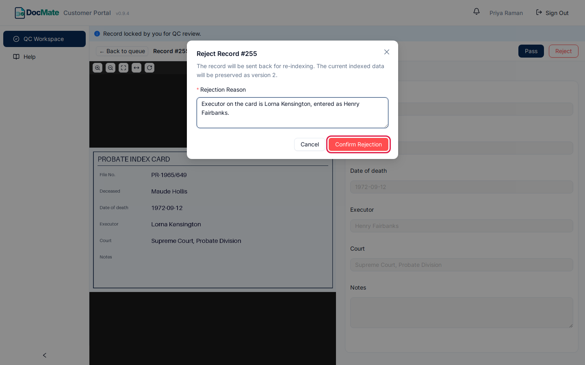

**Step 4.** A message, **"Record rejected — sent back for rework"**, confirms it. The current data is kept as a version, so the change history is never lost.

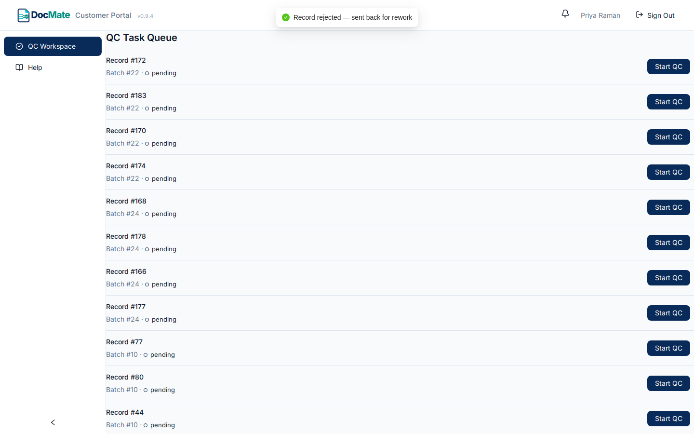

---

## 9. Leaving a review and coming back to it

You don't have to finish a record in one go.

**Step 1.** Click **← Back to queue**. Nothing is submitted.

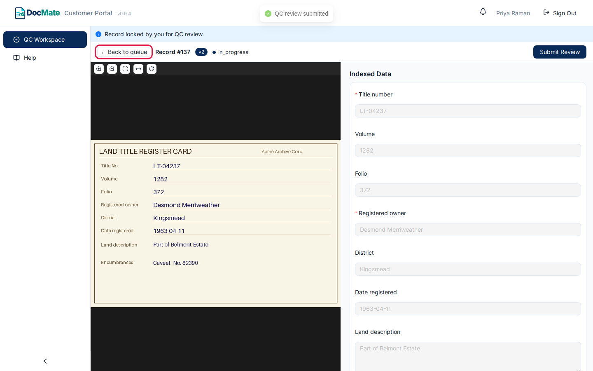

**Step 2.** The record stays in your queue as **in_progress**, still locked to you. When you're ready, click **Resume** to continue.

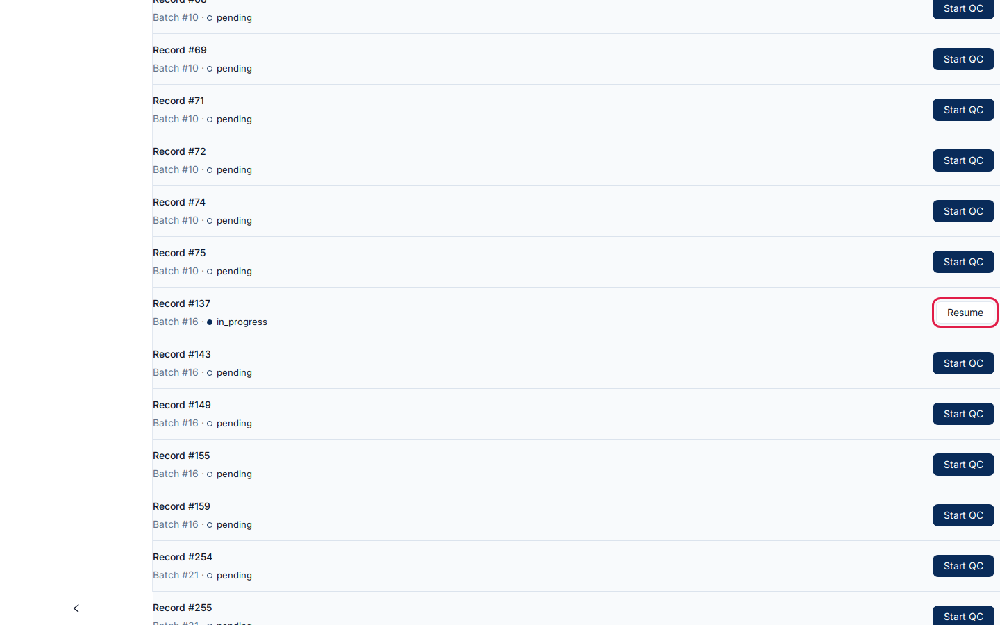

> - **Field marks aren't saved** until you submit. If you go back to the queue, they start again from Accepted.
> - **Don't leave records half-done for long.** A record locked to you can't be reviewed by anyone else, and the lot can't be decided until every sampled record has been reviewed. Your supervisor can move records you haven't finished to another reviewer; anything you hadn't submitted on them is then lost.
> - **Your time on a record** is counted only while you're working on it: the record is open, the window is in front, and you've clicked, typed or scrolled in the last few minutes. Time away from it isn't counted, and coming back adds to the time you'd already spent.

---

## 10. Good reviewing practice

- **Check the image, not your expectations.** Enter what the card says, even if it looks like a mistake on the original. Ask your supervisor how such cases should be treated.
- **Zoom in** on handwriting, faint stamps and small numbers.
- **Check every field**, including the optional ones and every row of lists such as *Encumbrances*.
- **Give the identifier fields extra care.** An error there is a critical defect, and one usually fails the whole lot.
- **Choose the error type carefully.** It decides whether a defect counts as major or minor. If you're not sure which one fits, ask your supervisor.
- **Write useful notes.** Say what the image shows and what was entered: "Card reads *Hollis*, entered *Hollins*" is far more useful than "wrong name".
- **Be consistent.** Apply the same standard to every record, whatever lot or batch it comes from.
- **Ask when unsure.** If you can't decide, go back to the queue without submitting and ask your supervisor, quoting the **Record #**.

---

## 11. Signing out

**Step 1.** Click **Sign Out** at the top right.

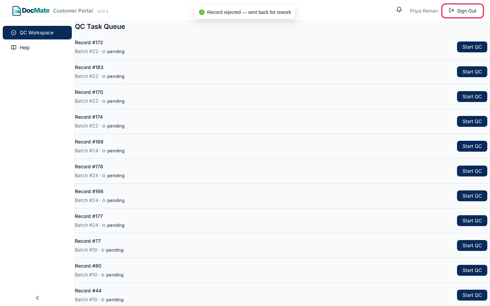

**Step 2.** You're returned to the sign-in page. It's now safe to close the browser.

> Always sign out on a shared computer. Closing the tab alone may leave you signed in.

---

## 12. Troubleshooting

| What you see | What to do |
|---|---|
| **"Unknown Portal"** when opening the portal | Check the address. The first part must be your organisation's portal name, for example `acme-archive`. |
| **"Invalid username or password"** | Retype your password, checking Caps Lock. Ask your administrator to reset it if needed. |
| **"You need to change your password to activate your account"** | You signed in with a temporary password. Choose your own ([Section 2](#2-signing-in)). |
| **"No QC tasks assigned to you"** | You have nothing to review. Your supervisor will assign more records; they appear automatically. |
| **A red "Record locked by user ID …" banner** | Another person has the record open. Don't review it. Go back to the queue and tell your supervisor. |
| **"Start the task to load the image."** | Click **Start QC**. The image loads once the review has started. |
| **"No image available for this record."** | The scan is missing. Don't guess: go back to the queue and tell your supervisor, quoting the **Record #**. |
| **The image is blank or slow** | Wait a few seconds; large scans take a moment to load. Then try **Fit Page**, or go back to the queue and **Resume**. |
| **Submit Review is greyed out** | A field is marked **Defective** but you haven't said what was wrong. Look for *"Choose what is wrong"* and click **Missing**, **Typo** or **Interpretation**. |
| **An error message when submitting** | Try again. If it keeps happening, note the message and tell your supervisor. Your verdict hasn't been recorded. |
| **You're asked to sign in again** | Your session ended after a period of inactivity. Sign in again and **Resume** the record. |

---

## 13. Glossary

| Term | Meaning |
|---|---|
| **Batch** | A group of records assigned to you as a unit of work |
| **Defect class** | Critical, major or minor: how serious a defect is. It follows from the error type and whether the field is an identifier. |
| **Defective** | A field that doesn't match the image |
| **Error type** | What was wrong with a defective field: **Missing** data, a **Typo**, or an **Interpretation** error |
| **Identifier field** | A field that identifies the record, such as the title number. Any error in it is a critical defect. |
| **Indexed data** | The information the digitization team typed up from the record's image |
| **ISO 2859‑1** | The international standard for sampling inspection that DocMate follows |
| **Lock** | While you review a record, it's locked to you so no one else can review it at the same time |
| **Lot** | A group of records the digitization team hands over together for checking |
| **QC (quality control)** | Checking that records were indexed correctly |
| **Sample** | The records picked at random from a lot for checking |
| **Version** | A saved copy of a record's data. A new version is saved whenever the data is indexed or corrected. |
