# DocMate Customer Portal — Supervisor User Manual

**For:** Customer supervisors

This manual takes a customer supervisor through everything they do in the DocMate Customer Portal, in the order they normally do it: signing in, receiving lots from the digitization team, sampling them, handing the sample to reviewers, acting on the result, answering the team's questions, following the project's progress, and signing out.

The examples use a fictitious customer, **Acme Archive Corp**, and its supervisor **Dana Whitfield**. Acme's reviewers are **Priya Raman**, **Marcus Bell** and **Lena Ortiz**. The digitization team's supervisor is **Sam Okafor**. Your own organisation's name, projects and people will appear in their place.

> **How to read the pictures.** A **red outline** marks the button or area to click in that step.

Reviewers have their own manual, the *Customer Portal — Reviewer User Manual*. It covers the QC Workspace in more depth than [Section 12](#12-the-qc-workspace) here.

> **What's new since version 0.9.0**
> - **Critical, major and minor defects, each with its own AQL.** An error in an identifier field (such as the title number) is critical. Other errors are major or minor depending on what was wrong, under an agreement you set: by default, missing data is major and typing or interpretation errors are minor. A lot is accepted only if every class stays within its own acceptance number ([Section 7](#7-lot-settings-and-the-aql-configuration), [Section 10](#10-following-qc-and-reading-the-result)).
> - **You decide how much of the sample to hand out.** When assigning, you choose how many batches to create and how many records go in each. Anything you don't assign stays unassigned for later. Batches can go to reviewers, to other supervisors or to yourself ([Section 9](#9-assigning-the-sample-to-reviewers)).
> - **A new QC Batches page** lists every batch, who holds it and how far it has got, and lets you **reassign** a batch's open records to someone else ([Section 9](#9-assigning-the-sample-to-reviewers)).
> - **Search on Flagged Records** finds a flag by record, issue or anything said in its discussion ([Section 13](#13-flagged-records-guiding-the-digitization-team)).
> - **Time per record in Staff Productivity.** Click a reviewer's name to see each record they reviewed and how long it took. Time now adds up across sittings, and time away from a record isn't counted ([Section 16](#16-staff-productivity)).
> - AQLs of 4.0 % and 6.5 % are now available.

---

## Contents

1. [Your role](#1-your-role)
2. [How a lot moves through customer QC](#2-how-a-lot-moves-through-customer-qc)
3. [Signing in](#3-signing-in)
4. [Finding your way around](#4-finding-your-way-around)
5. [Lots: the list and what each status means](#5-lots-the-list-and-what-each-status-means)
6. [Reading the outgoing inspection report](#6-reading-the-outgoing-inspection-report)
7. [Lot settings and the AQL configuration](#7-lot-settings-and-the-aql-configuration)
8. [Applying the sample](#8-applying-the-sample)
9. [Assigning the sample to reviewers](#9-assigning-the-sample-to-reviewers)
10. [Following QC and reading the result](#10-following-qc-and-reading-the-result)
11. [When a lot fails: sending it for remediation](#11-when-a-lot-fails-sending-it-for-remediation)
12. [The QC Workspace](#12-the-qc-workspace)
13. [Flagged records: guiding the digitization team](#13-flagged-records-guiding-the-digitization-team)
14. [Notifications](#14-notifications)
15. [Project KPIs](#15-project-kpis)
16. [Staff Productivity](#16-staff-productivity)
17. [Record History](#17-record-history)
18. [Signing out](#18-signing-out)
19. [Troubleshooting](#19-troubleshooting)
20. [Glossary](#20-glossary)

---

## 1. Your role

A digitization team indexes your records: they type up the information on each card or page so it can be searched. Before handing the work over, the team checks it twice:
- Their QA staff review each record.
- Their supervisor inspects a sample of every **lot** (a group of records handed over together).

Customer QC is your organisation's own independent check of that work, and you run it.

| You (Customer Supervisor) | Your reviewers (Customer QC agents) |
|---|---|
| See every lot the team releases to you | See only the records assigned to them |
| Choose how lots are sampled (the AQL configuration) | Compare each sampled record with its image |
| Draw the sample and assign it to reviewers | Accept the record, mark defects, or reject it |
| Decide what happens when a lot fails | |
| Answer the team's questions on flagged records | |
| Follow the project's progress, quality and history | |

Only supervisors see the **Lots**, **QC Batches**, **Project KPIs**, **Staff Productivity**, **Record History** and **Flagged Records** pages. The server enforces this, so a reviewer can't open them even by typing the address.

---

## 2. How a lot moves through customer QC

```
 Digitization team                       You and your reviewers
 ─────────────────                       ──────────────────────
 Index → QA → outgoing inspection
            │
            ▼  releases the lot
        ┌──────────┐  Apply sample  ┌────────────────┐  all sampled   ┌────────┐
        │ Released │ ─────────────▶ │ QC In Progress │ ─────────────▶ │ Passed │
        └──────────┘                └────────────────┘  records done  └────────┘
              ▲                              │
              │                              ▼
              │                         ┌────────┐  Send for     ┌─────────────┐
              │                         │ Failed │ ────────────▶ │ Remediation │
              │                         └────────┘  Remediation  └─────────────┘
              │                                                        │
              └────── team fixes the rejected records and resubmits ───┘
                      (the lot comes back for QC round 2, 3, …)
```

1. The digitization team **releases** a lot to you after it passes their own outgoing inspection.
2. You **apply a sample**. DocMate picks which records will be checked, and the lot moves to **QC In Progress**.
3. You **assign** the sampled records to reviewers in batches, and they review them.
4. When the last sampled record has been reviewed, DocMate decides the result automatically: **Passed** or **Failed**.
5. If the lot failed, you **send it for remediation**. The team corrects the rejected records and resubmits the lot, and it comes back to you as a new **QC round**.

---

## 3. Signing in

Your DocMate administrator gives you two things:
- **Your organisation's portal address.** For Acme it is `https://acme-archive.docmate.local`. The first part of the address identifies your organisation, so there's no company selector on the sign-in page.
- **Your username and password.** Your username is your email address.

**Step 1.** Open your portal address in a web browser. Chrome, Edge, Firefox and Safari all work. The page shows **"Connecting…"** for a moment, then your organisation's sign-in page appears.


**Step 2.** Enter your email address and password, then click **Sign In**.

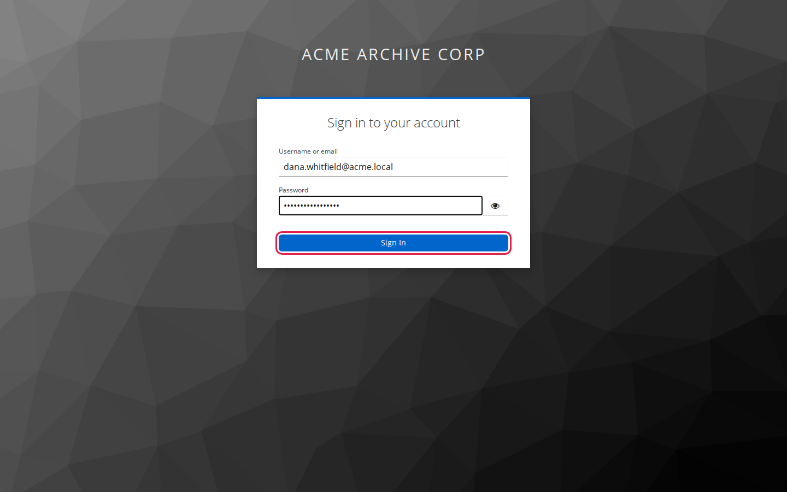

**Step 3 (first sign-in only).** The password your administrator gave you is temporary, so you're asked to choose your own. The page says *"You need to change your password to activate your account."*

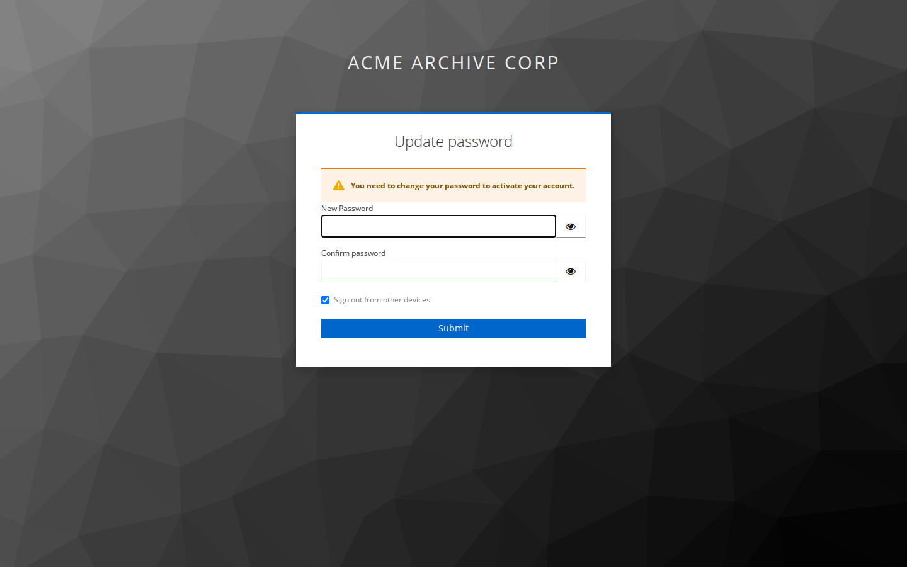

Type a new password in **New Password** and again in **Confirm password**, then click **Submit**. Leave **Sign out from other devices** ticked unless you have a reason not to.

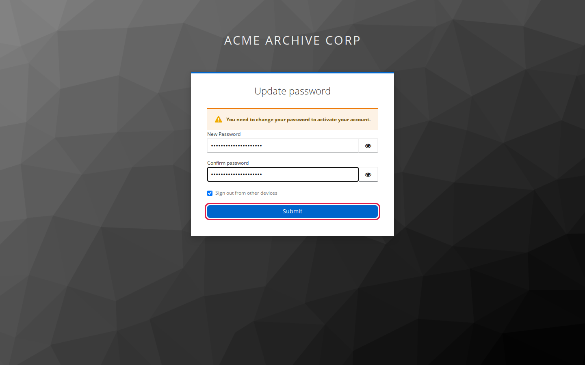

**Step 4.** The portal opens on the **QC Workspace**, which is everyone's home page. Supervisors' review queues are usually empty; see [Section 12](#12-the-qc-workspace).

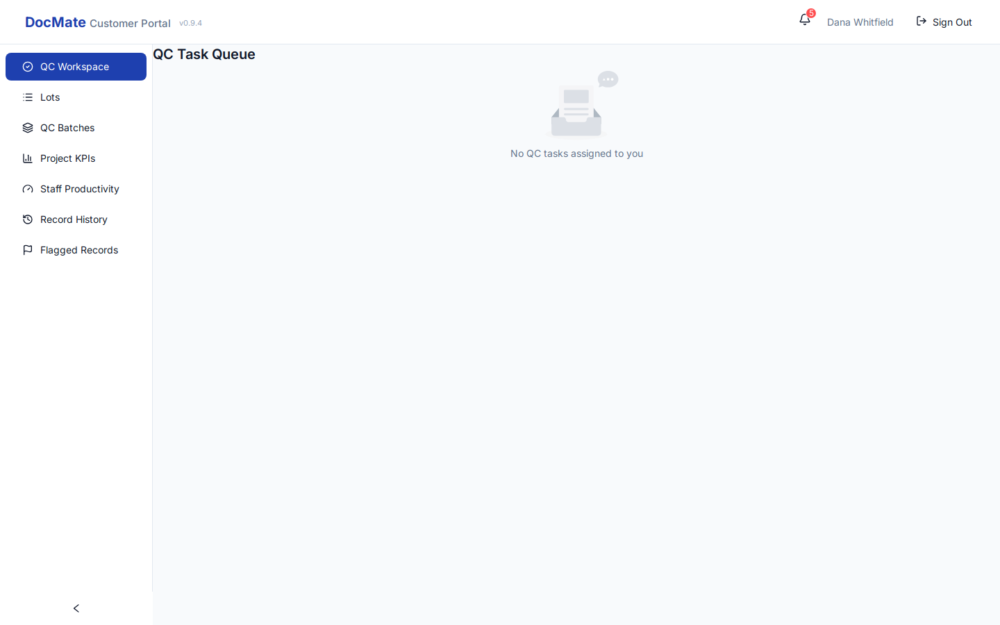

From now on, sign in with your email address and your new password. If you forget it, ask your administrator to reset it; you'll be asked to choose a new one again.

**Staying signed in.** DocMate keeps you signed in while you're working: clicking, typing or scrolling all count. After about half an hour without any activity, you'll be asked to sign in again. Anything you'd already saved is kept.

---

## 4. Finding your way around

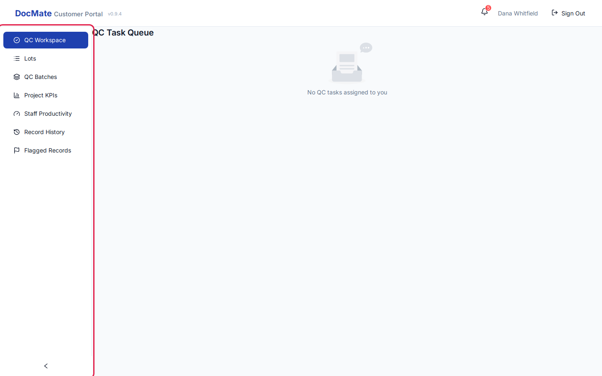

**The menu (left).** It has seven pages:

| Menu item | What it is for |
|---|---|
| **QC Workspace** | Reviewing records assigned to you ([Section 12](#12-the-qc-workspace)) |
| **Lots** | Lots released to you: sampling, assigning and results ([Sections 5–11](#5-lots-the-list-and-what-each-status-means)) |
| **QC Batches** | Every batch of review work you've handed out, with Reassign ([Section 9](#the-qc-batches-page)) |
| **Project KPIs** | Progress, deadline and quality figures for a project ([Section 15](#15-project-kpis)) |
| **Staff Productivity** | What each reviewer has done ([Section 16](#16-staff-productivity)) |
| **Record History** | The full audit trail of any record ([Section 17](#17-record-history)) |
| **Flagged Records** | Questions the digitization team has asked you ([Section 13](#13-flagged-records-guiding-the-digitization-team)) |

The arrow at the bottom of the menu collapses it to icons. On a phone or narrow window, the menu is behind the **☰** button at the top left.

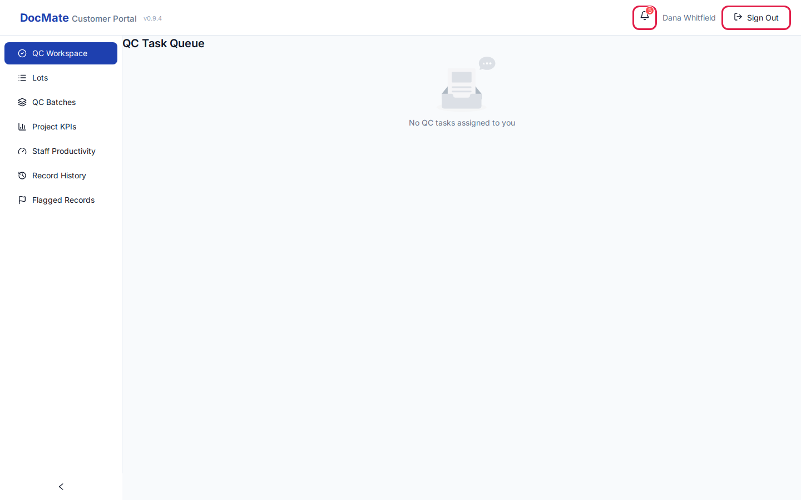

**The header (top).** From left to right:
- The DocMate version.
- The **notifications bell**. The red number is your unread notifications.
- Your name.
- **Sign Out**.

### Choosing a project

Lots, QC Batches, Project KPIs, Staff Productivity, Record History and Flagged Records all show one project at a time. When you first open one of these pages, it asks you to choose a project.

**Step 1.** Click the **Project** box.

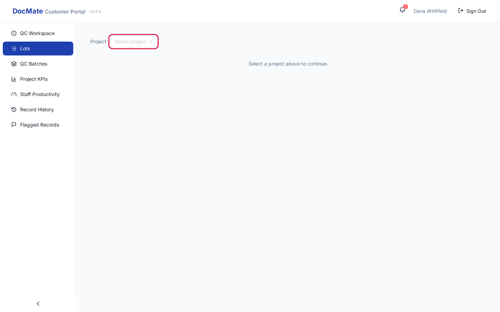

**Step 2.** Pick the project from the list.

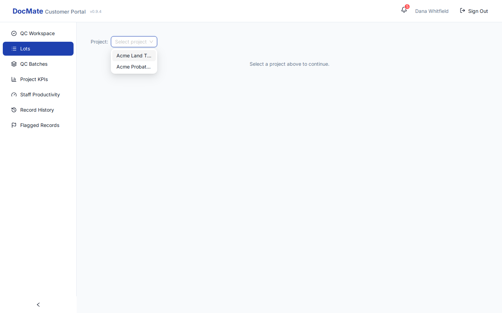

The project you choose is remembered as you move between pages. It's also part of the page address, so a bookmarked or shared link opens on the same project.

---

## 5. Lots: the list and what each status means

Click **Lots** in the menu and choose a project.

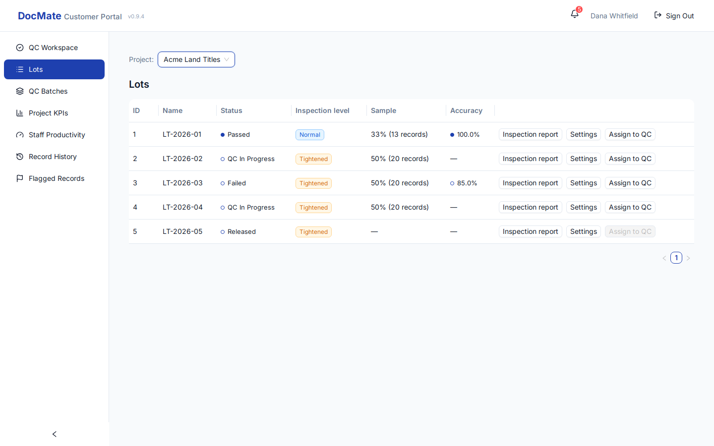

Each row is a lot the digitization team has released to you. Lots the team is still preparing don't appear here.

| Column | Meaning |
|---|---|
| **ID / Name** | The lot's number and the name the team gave it |
| **Status** | Where the lot is (see below) |
| **Inspection level** | **Normal**, **Tightened** or **Reduced**: the ISO 2859‑1 level the lot is sampled at ([Section 7](#7-lot-settings-and-the-aql-configuration)). Once sampled, it's the level the sample was drawn at. |
| **Sample** | The sample taken, as a percentage and a number of records. "—" until you apply a sample. |
| **Accuracy** | The share of sampled records your reviewers passed. Shown once QC is complete. |

| Status | What it means | What you do next |
|---|---|---|
| **Released** | Handed over and waiting for you | [Apply a sample](#8-applying-the-sample) |
| **QC In Progress** | Sampled, and reviewers are working on it | [Assign](#9-assigning-the-sample-to-reviewers) any sampled records not yet assigned, then [follow progress](#10-following-qc-and-reading-the-result) |
| **Passed** | QC is finished and the lot met your quality standard | Nothing. The lot is accepted. |
| **Failed** | QC is finished and the lot did not meet your standard | [Send it for remediation](#11-when-a-lot-fails-sending-it-for-remediation) |
| **Remediation** | Sent back to the team to correct the rejected records | Wait for the team to resubmit it |

Each row has three buttons:
- **Inspection report** shows the digitization team's own check of the lot.
- **Settings** opens the lot's details, the project's AQL configuration, the sample and the history.
- **Assign to QC** hands sampled records to reviewers in batches. It's greyed out until a sample has been applied.

The list refreshes itself every few seconds.

---

## 6. Reading the outgoing inspection report

Before releasing a lot, the digitization team's supervisor inspects a random sample under ISO 2859‑1. The lot is released only if that inspection passes. The report tells you what they checked and what they found.

**Step 1.** Click **Inspection report** on the lot's row.

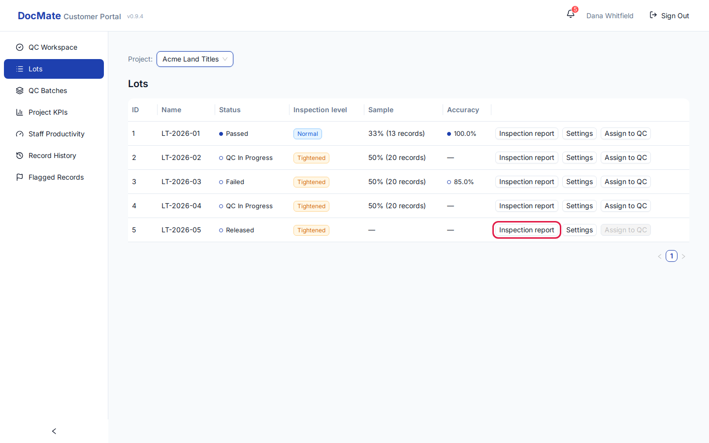

**Step 2.** Read the report.

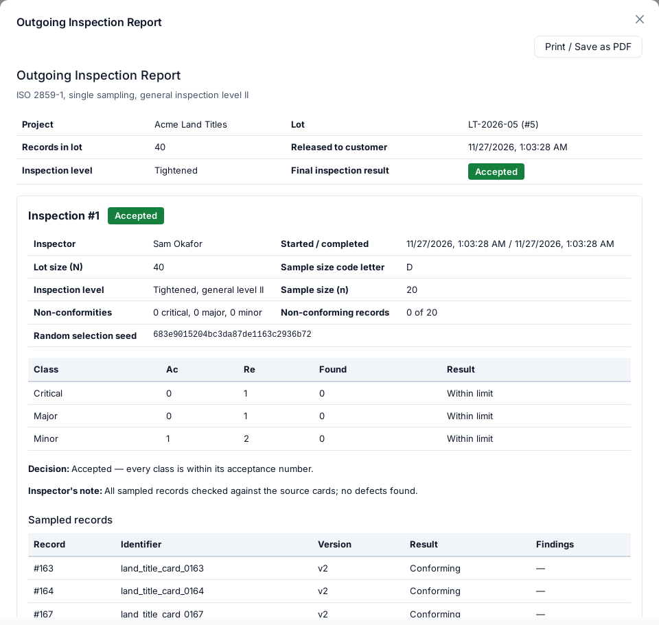

The report shows:
- The lot's **inspection level** (Normal, Tightened or Reduced) and, for each attempt, the **general inspection level** (I, II or III).
- **Lot size (N)**, the **sample size code letter** and the **sample size (n)** of the plan the inspector used.
- **Non-conformities** found in each class (critical, major and minor), and how many sampled records had any.
- A table with one row per class: its **acceptance (Ac)** and **rejection (Re)** numbers, how many were **found**, and whether that class was **within limit**. **Decision** explains the result in one line, for example *"Accepted — every class is within its acceptance number."*
- **Random selection seed.** This makes the sample reproducible: anyone can confirm which records the random draw chose.
- **Sampled records**, showing each record, its version and the inspector's finding.
- **The inspector's note.**

If the lot was inspected more than once, every attempt is listed, for example a failed inspection followed by a passed re-inspection.

Click **Print / Save as PDF** to keep a copy. Close the report with the **×**.

> The team's inspection doesn't replace your QC. It's evidence of how they checked the work before handing it over.

---

## 7. Lot settings and the AQL configuration

Click **Settings** on a lot's row to open its details on the right.

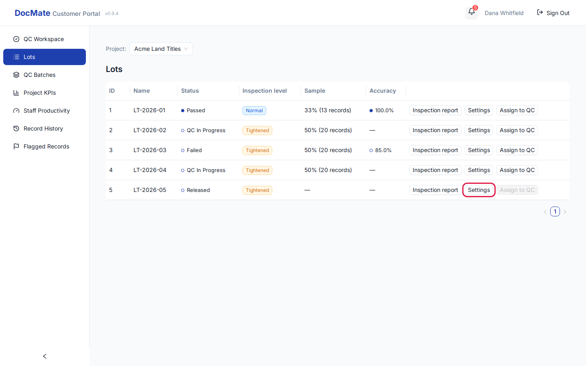

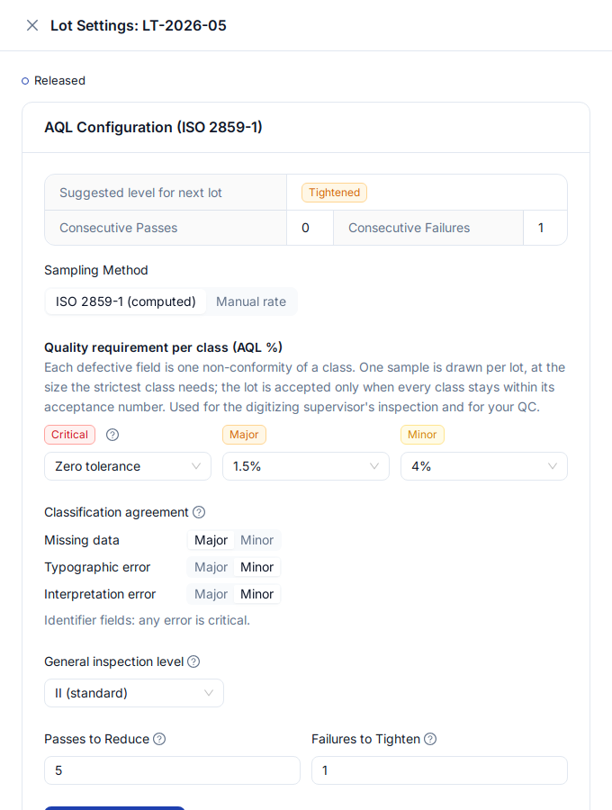

From top to bottom, the panel shows:
- The lot's **status** and, once known, its **accuracy**.
- The **AQL configuration** (below).
- The **sample**, with the acceptance and rejection numbers for each defect class.
- The **QC field defect tabulation**, once reviewers have started.
- **Earlier QC rounds**, if the lot has been resubmitted.
- **Records, showing which were chosen.** Sampled rows are highlighted.
- **Lot history**.

### Inspection levels

Every lot is sampled at one of three ISO 2859‑1 **inspection levels**:

| Level | What it means |
|---|---|
| **Normal** | The standard sample size and acceptance number. Projects start here. |
| **Tightened** | Stricter: larger samples and/or fewer defects allowed. Used after rejected lots. |
| **Reduced** | Smaller samples. Used after a run of accepted lots. |

DocMate works out a **suggested level** for the next lot from your recent QC results (*switching*, see the settings below). The digitization team's supervisor **sets each lot's level** when they inspect it before release, and normally follows the suggestion. Your sample for that lot is then drawn at the same level. You can see each lot's level in the **Inspection level** column of the Lots page and in its **Sample** card.

In the example, LT‑2026‑01 was sampled at **Normal** (13 of its 40 records). LT‑2026‑02 then failed its first QC round, so the suggested level became **Tightened**, and the lots released after it were inspected and sampled at Tightened (20 of 40 records).

### Defect classes

Each defective field your reviewers find is one **non-conformity**, and each non-conformity belongs to one of three classes:

| Class | Which errors | Typical AQL |
|---|---|---|
| **Critical** | Any error in an **identifier field**: a field that identifies the record, such as the title number or the registered owner. The digitization team marks these fields in the document type, and reviewers see them tagged **Identifier**. | **Zero tolerance**: one critical defect rejects the lot |
| **Major** | Errors of a type your agreement classes as major. By default, **missing data** (a value on the image that wasn't entered). | 1.5 % |
| **Minor** | Errors of a type your agreement classes as minor. By default, **typographic errors** (wrong, extra or swapped characters) and **interpretation errors** (the source was read or understood wrongly). | 4.0 % |

When reviewers mark a field defective, they say what was wrong: **Missing**, **Typo** or **Interpretation**. DocMate works out the class from that and from whether the field is an identifier.

Each class has its own AQL, and so its own **acceptance number (Ac)** and **rejection number (Re)**. One sample is drawn per lot, at the size the strictest class needs. The lot is **accepted only when every class is within its acceptance number**.

### The AQL configuration

These settings belong to the **project**, not to one lot. A change applies to every lot you sample from then on, and doesn't change lots already sampled.

| Setting | Meaning |
|---|---|
| **Suggested level for next lot** | **Normal**, **Tightened** or **Reduced**: the level the switching rules suggest for the next lot (see above) |
| **Consecutive passes / failures** | The run of passed or failed lots that drives switching |
| **Sampling method** | **ISO 2859‑1 (computed):** DocMate works out the sample size and the acceptance numbers from the lot size, the AQLs and the lot's inspection level. **Manual rate:** you choose a percentage of the lot. |
| **Quality requirement per class (AQL %)** | One AQL for each class: **Critical**, **Major** and **Minor**. Choose from 0.65 %, 1.0 %, 1.5 %, 2.5 %, 4.0 % and 6.5 %; critical can also be **Zero tolerance**. A lower AQL is stricter. The same AQLs apply at every inspection level; the level changes the sample size and acceptance numbers. |
| **Classification agreement** | For each kind of error (**Missing data**, **Typographic error**, **Interpretation error**), whether it counts as **Major** or **Minor**. Errors in identifier fields are always critical. |
| **General inspection level** | Which column of ISO 2859‑1's table turns a lot's size into a sample size. **II (standard)** is the default. **III** draws larger samples (for example, a 1,000-record lot gets code letter K instead of J), **I** smaller ones. Applies to lots inspected from now on. |
| **Passes to reduce** | The number of accepted lots in a row after which the suggested level moves from tightened back to normal, or from normal to reduced |
| **Failures to tighten** | The number of rejected lots in a row after which the suggested level moves from normal to tightened. Under reduced inspection, a single rejected lot suggests normal again. |

**Switching** uses each lot's **first** QC round only. A resubmitted lot's later rounds never change the suggested level.

Hover over the **?** beside a setting for a short explanation. To change the settings, edit the values and click **Save Configuration**. The digitization team's supervisor uses the same AQLs and agreement for their own inspection before release.

> Agree the AQLs, the classification agreement and the general inspection level with the digitization team before the project starts. Changing them part-way makes lots harder to compare. Lots already sampled keep the settings they started with.

---

## 8. Applying the sample

Applying the sample picks, at random, which records your reviewers will check. Do this once for each lot with status **Released**.

**Step 1.** Open the lot's **Settings**.

**Step 2.** In the **Sample** card, check the figures.
- **ISO projects** show the lot's **inspection level**, the **ISO sample size**, and each class's **AQL**, **acceptance number (Ac)** and **rejection number (Re)**. In the example, LT‑2026‑05 is at **Tightened**, so 20 of its 40 records are sampled. No critical or major defect is allowed (Ac 0), and one minor defect is (Ac 1).
- **Manual-rate projects** show a slider instead. Set the percentage, and the panel tells you roughly how many records that is.

**Step 3.** Click **Apply ISO Sample**. On manual-rate projects, the button is **Apply Sample**.

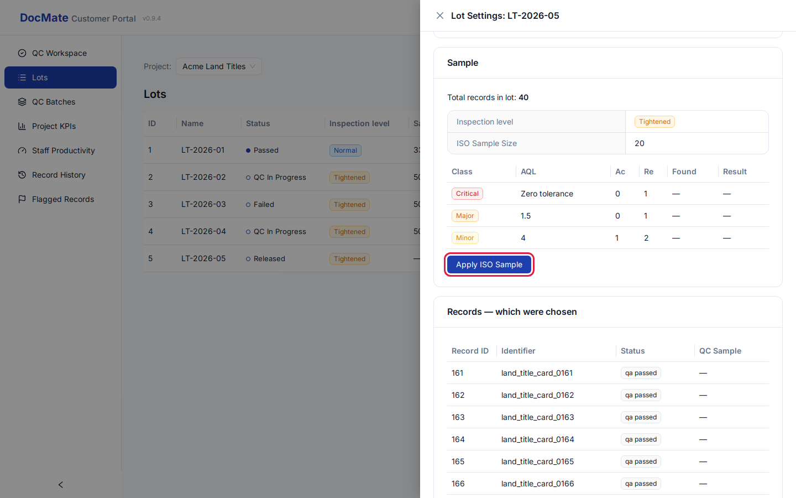

**Step 4.** A message, **"Sample applied — records selected for QC"**, confirms it. The lot is now **QC In Progress**. In **Records, showing which were chosen**, the sampled records are highlighted and marked **Sampled**.

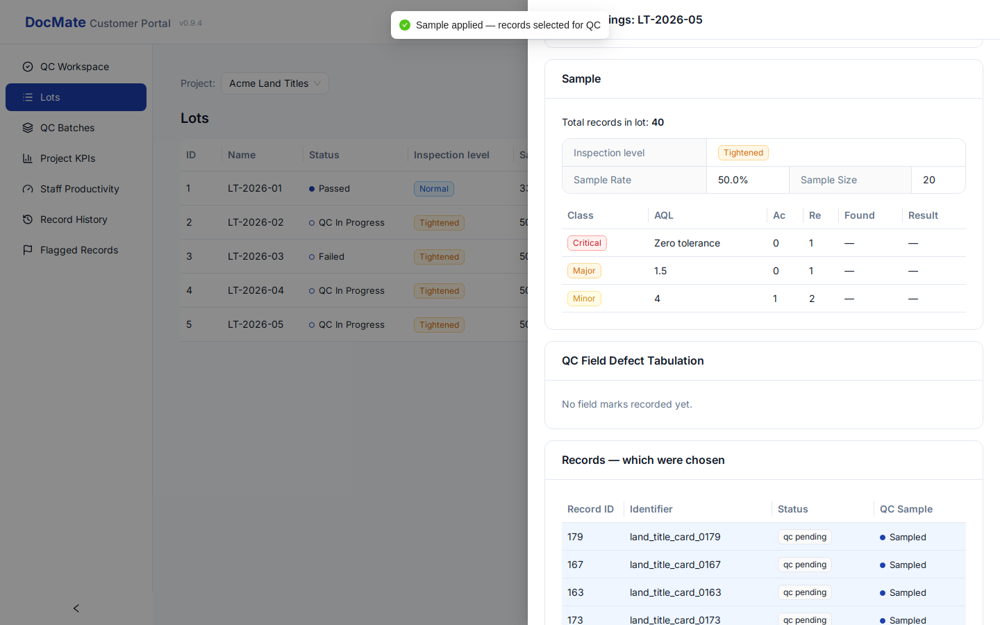

> A sample can't be redrawn once applied: a sample you could change wouldn't be a fair random sample. If you applied it by mistake, contact the digitization team.

Close the panel with the **×** at its top left.

---

## 9. Assigning the sample to reviewers

You hand sampled records out in **QC batches**. A batch is a set of records that goes to one person's QC Workspace. You choose how many batches to create and how many records go in each, so you can hand out the whole sample at once or a part of it now and the rest later.

**Step 1.** Click **Assign to QC** on the lot's row.

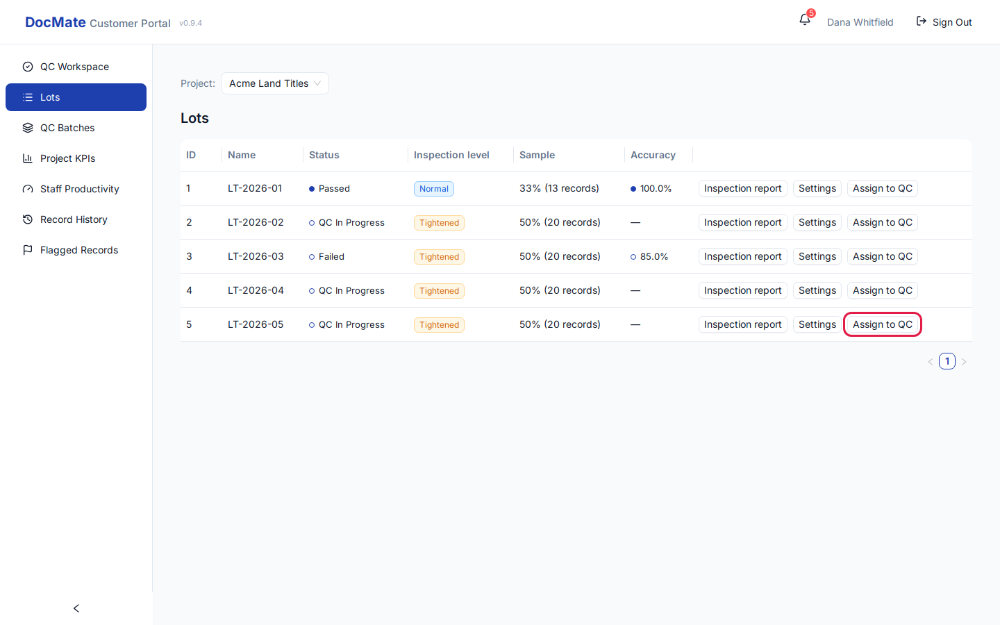

The panel has three parts:
- **Assign batches**, the form for handing out records. Its title says how many sampled records are still unassigned.
- **QC batches for this lot**, the batches already handed out.
- **Sampled records**, every sampled record with who it's assigned to and how its review is going.

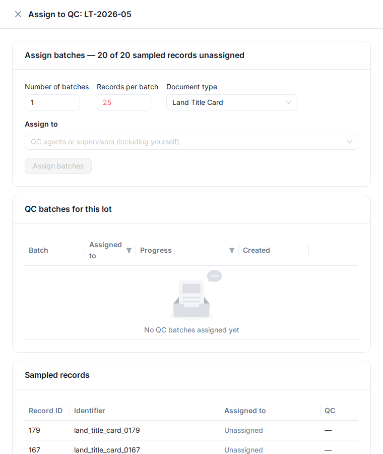

**Step 2.** Fill in the form:
- **Number of batches:** how many batches to create now.
- **Records per batch:** how many records go in each batch.
- **Document type:** the kind of record in the lot, here *Land Title Card*. This decides which fields reviewers check. A project with only one document type fills it in for you.
- **Assign to:** start typing a name and pick one or more people. You can pick reviewers, other supervisors, or yourself (marked **(you)**).

The line under **Assign to** shows what will happen. Batches go to the people you picked in turn. In the example, 3 batches of 4 records hand out 12 of the 20 sampled records: 2 batches (8 records) for Priya and 1 batch (4 records) for Marcus. The other **8 stay unassigned for later**.

**Step 3.** Click **Assign 3 batches**. The button shows the number of batches you're creating.

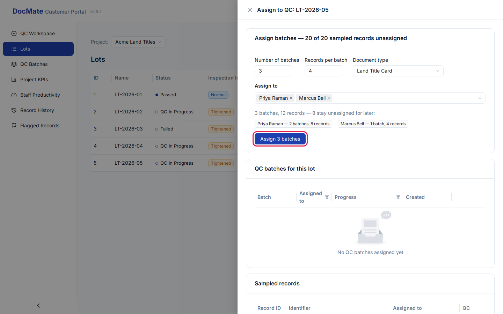

**Step 4.** A message, **"3 QC batches assigned"**, confirms it. The records appear straight away in each person's QC Workspace. The form's title now shows how many records are still unassigned; you can come back at any time and assign them in the same way.

The new batches are listed under **QC batches for this lot**, with who holds each one and its progress.

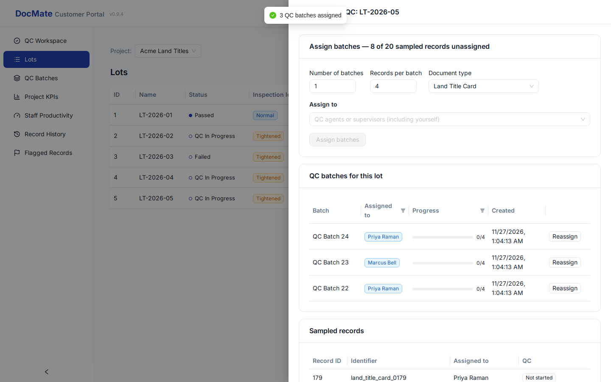

> **Tips**
> - Share a sample between two or more reviewers so no one person's judgement decides a lot.
> - A lot's result is decided only when **every** sampled record has been reviewed, so don't leave records unassigned for long.
> - Only active reviewers and supervisors from your own organisation can be chosen. If someone is missing, ask your administrator to add them or reactivate their account.

### The QC Batches page

Click **QC Batches** in the menu to see every batch handed out on the project, across all its lots. Newest batches are at the top.

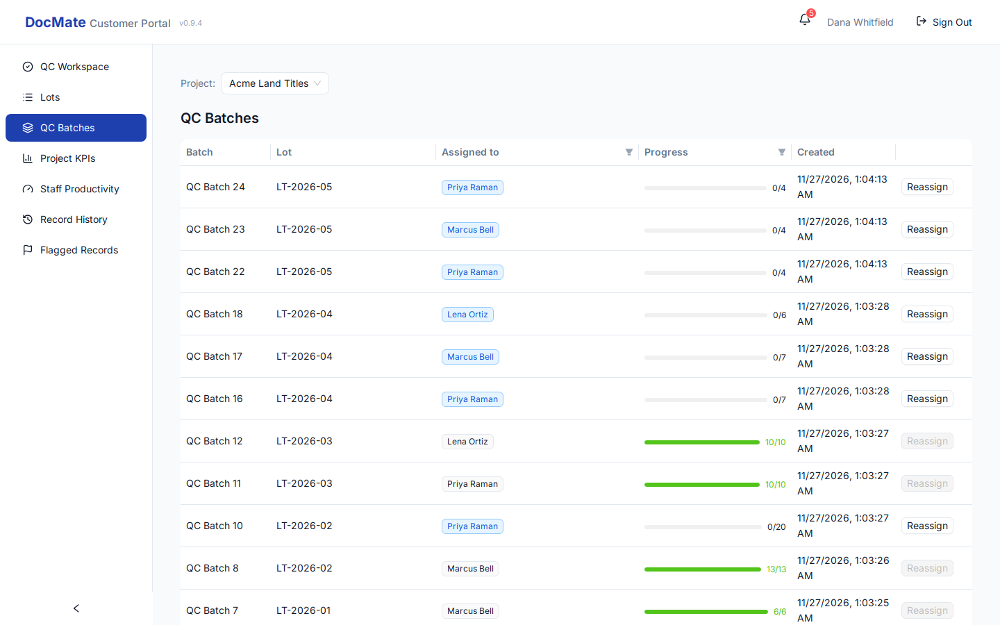

| Column | Meaning |
|---|---|
| **Batch** | The batch's name. Hover over it to see the full name. |
| **Lot** | The lot the batch's records come from |
| **Assigned to** | Who holds the batch. A blue name still has records open; hover over it to see how many. Supervisors are marked **· supervisor**. |
| **Progress** | Records reviewed out of the batch's total. Hover over the bar for the breakdown: passed, rejected, in progress and not started. |
| **Created** | When the batch was handed out |

To narrow the list, click the filter icon in the **Assigned to** column to pick people, or in the **Progress** column to show only batches that are **Not started**, **In progress** or **Finished**.

### Reassigning a batch

If a reviewer is away or has too much work, move their open records to someone else.

**Step 1.** Click **Reassign** on the batch's row. It's greyed out once every record in the batch has been reviewed.

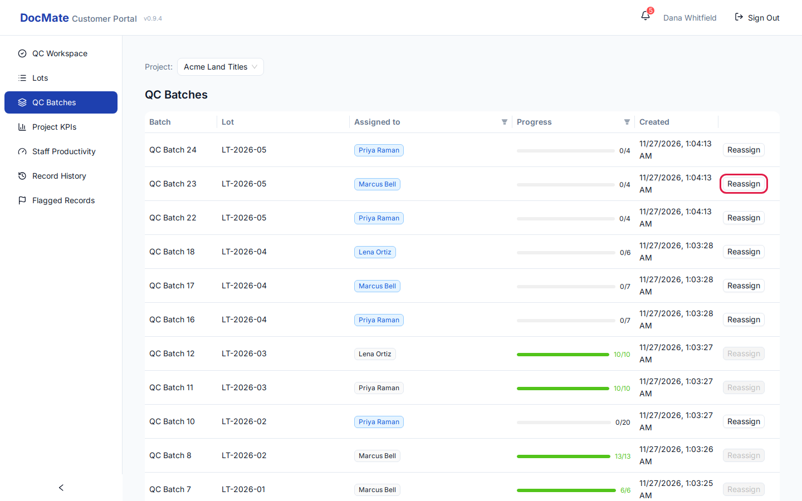

**Step 2.** Pick the person to take over, then click **Reassign**.

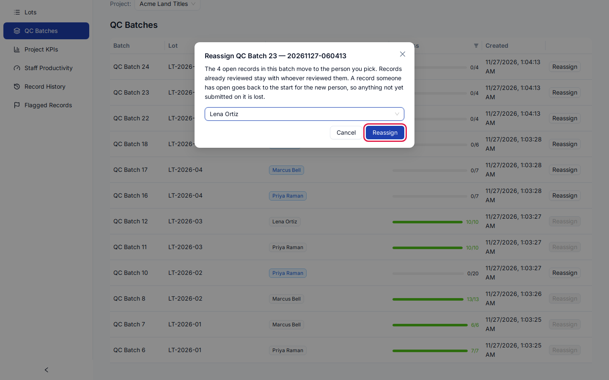

The batch's **open** records move to that person. Records already reviewed stay with whoever reviewed them. If someone had a record open, it starts again from the beginning for the new person, so anything they hadn't submitted on it is lost.

**Step 3.** A message, for example **"4 open records reassigned"**, confirms it.

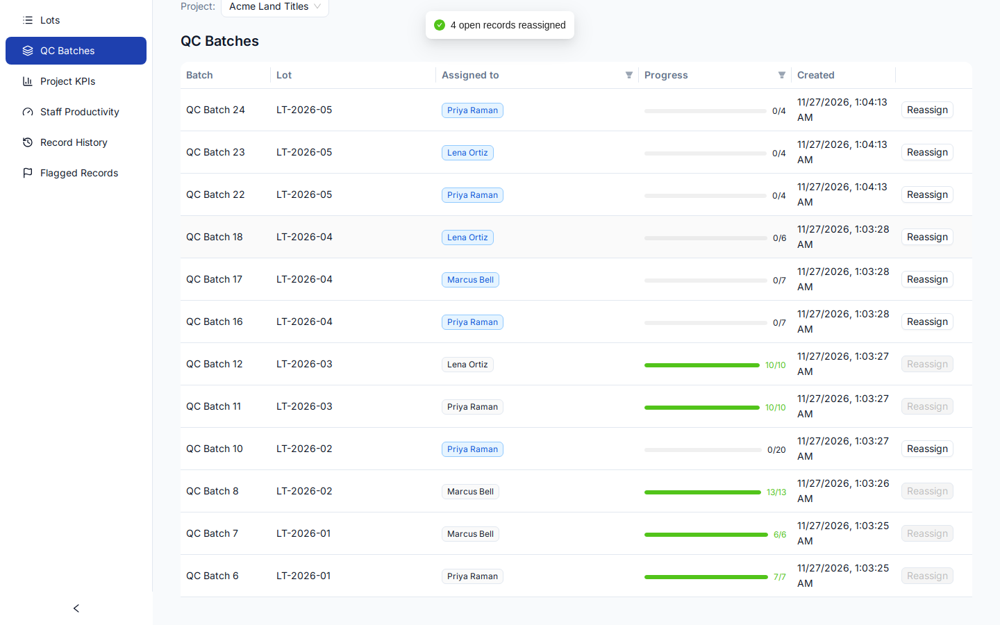

You can also reassign from the **QC batches for this lot** list in the **Assign to QC** panel.

---

## 10. Following QC and reading the result

Open the lot's **Settings** at any time to see how QC is going. In the **Records, showing which were chosen** list, each sampled record's status changes as reviewers work:
- **qc pending:** waiting for review.
- **qc passed:** accepted.
- **qc failed:** rejected.

### How DocMate decides the result

When the last sampled record has been reviewed, DocMate sets the lot to **Passed** or **Failed** straight away. Nobody has to press a button.

- **ISO projects.** Reviewers mark each field as accepted or defective, and say what was wrong with each defective field. DocMate counts the defects in each class (critical, major and minor). The lot **fails** if any class reaches its **rejection number**. Otherwise, with every class within its acceptance number, it **passes**.
- **Manual-rate projects.** Reviewers pass or reject whole records. The lot **passes** when at least **90 %** of the sampled records passed.

### The QC field defect tabulation (ISO projects)

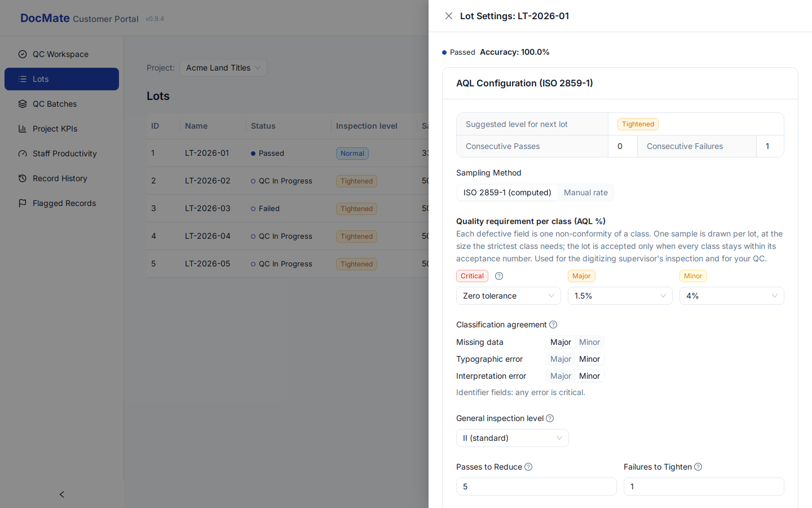

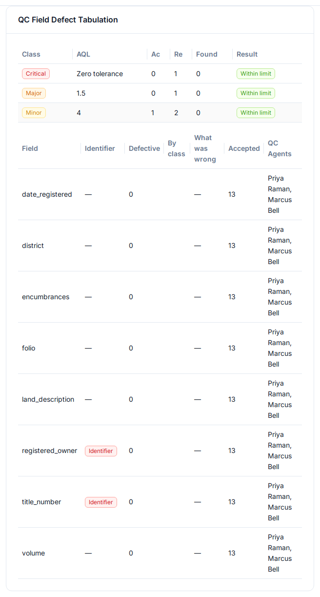

The first table has one row per class: its **AQL**, **acceptance (Ac)** and **rejection (Re)** numbers, the defects **found**, and the **result**: **Within limit** or **Rejects lot**.

Below it, for each field, the tabulation shows:
- whether the field is an **identifier** (any error in it is critical);
- how many times it was marked **defective**;
- **by class:** how many of those defects were critical, major or minor;
- **what was wrong:** missing data, typographic or interpretation errors;
- how many times it was **accepted**;
- which **QC agents** marked it.

Use the tabulation to see which fields cause most of the errors, and what kind of errors they are, and raise those with the digitization team.

### Lot history

At the bottom of the panel, **Lot history** lists everything that has happened to the lot: release, sampling, QC completion, remediation and so on. Each entry shows who did it and when. Click **Lot history** to expand it.

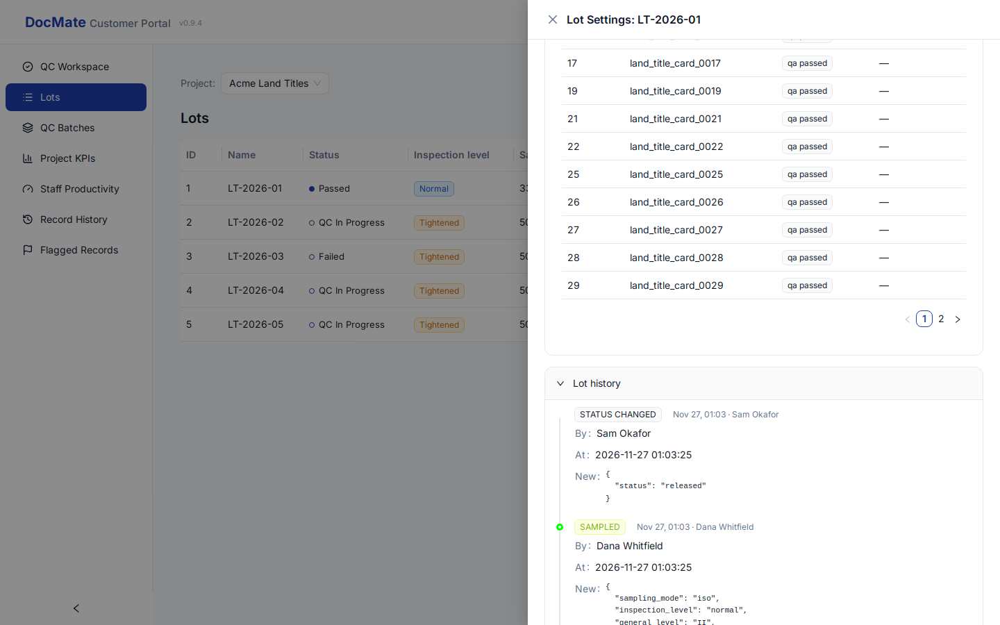

---

## 11. When a lot fails: sending it for remediation

A failed lot shows a red banner at the top of its **Settings**, saying which classes failed. In the example: *"Lot failed QC — major and minor non-conformities reached the rejection number."*

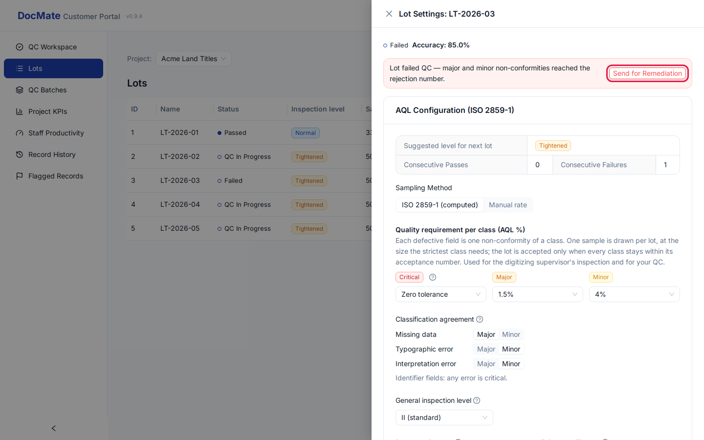

**Step 1.** Scroll down to the **QC field defect tabulation** to see which fields were defective. In the example, LT‑2026‑03 was sampled at Tightened, where no major defect and one minor defect are allowed. The reviewers found one major defect (an encumbrance on the card that wasn't entered) and two minor ones (a mistyped folio and a misread district), so both the major and the minor class reject the lot. Each rejected record also keeps the reviewer's note, which you can see in [Record History](#17-record-history).

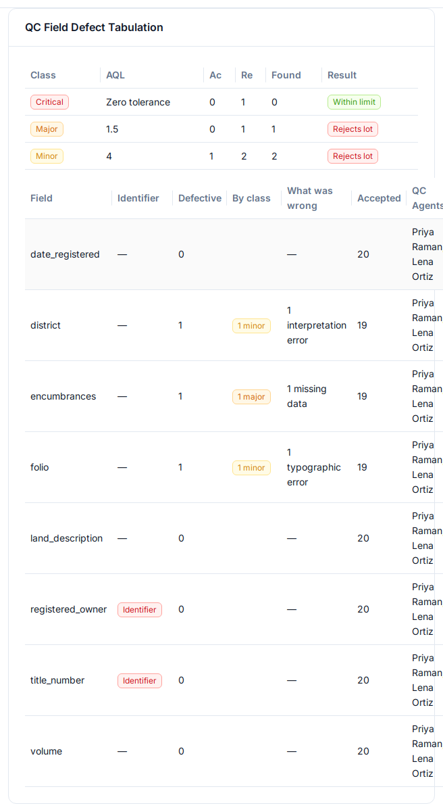

**Step 2.** Click **Send for Remediation** in the red banner.

**Step 3.** A message, **"Lot sent for remediation"**, confirms it. The lot's status changes to **Remediation**.

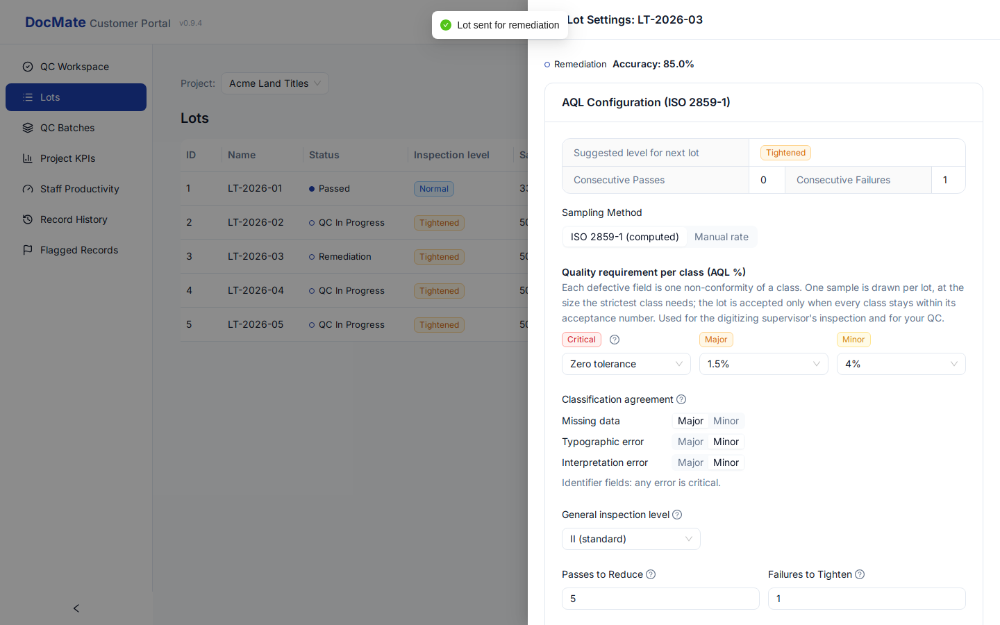

### What happens next

1. Every record your reviewers rejected goes back to the digitization team's QA, who correct it.
2. When all of them are fixed, the team **resubmits** the lot. They inspect it again, and it comes back to you as **Released** on its next **QC round**.
3. You apply a fresh sample and assign it, exactly as before ([Sections 8–9](#8-applying-the-sample)). Records that passed last time can be sampled again.

A resubmitted lot's **Settings** shows an **Earlier QC rounds** card. It summarises every finished round: its result, inspection level, sample, accuracy, defects and completion date. In the example, LT‑2026‑02 failed round 1 (13 of 40 records, sampled at Normal) with one critical defect, a mistyped registered owner, and is now on round 2 at Tightened.

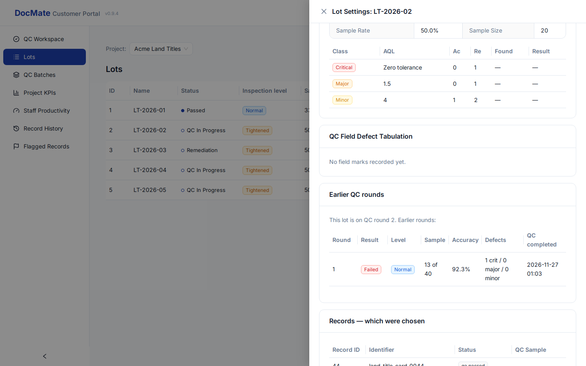

> Only a lot's first round counts towards the suggested inspection level ([Section 7](#7-lot-settings-and-the-aql-configuration)).

The lot list after these steps:

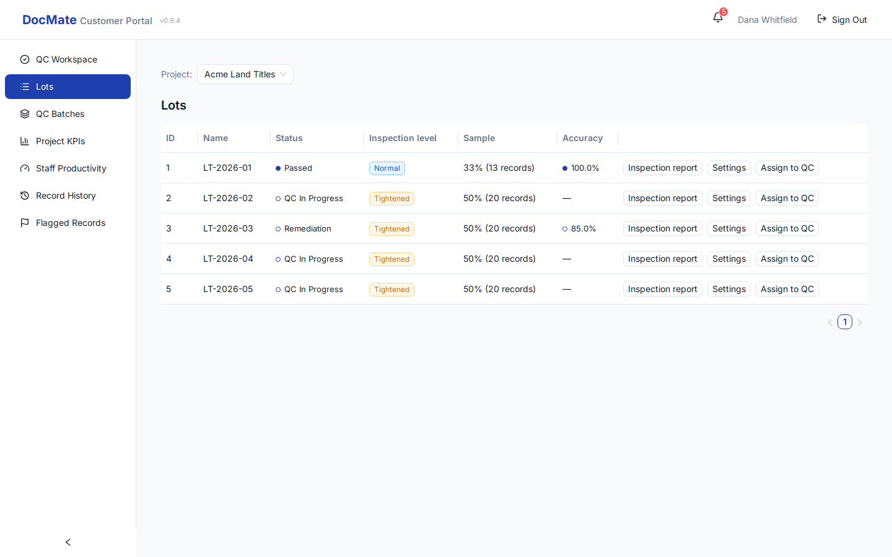

---

## 12. The QC Workspace

As a supervisor you see the **QC Workspace** too, because it's everyone's home page. It lists the records assigned to **you**. Usually that's nothing, and it shows *"No QC tasks assigned to you"*.

You can review records yourself by picking your own name (marked **(you)**) when you assign batches ([Section 9](#9-assigning-the-sample-to-reviewers)), or another supervisor can assign some to you. They then appear in your QC Workspace, and you review them exactly as a reviewer does. How reviewing works is described in the *Reviewer User Manual*.

---

## 13. Flagged records: guiding the digitization team

Sometimes an indexer can't tell how a record should be entered. A name might be crossed out, a corner torn off, or a date impossible. They **flag** the record. When the team needs your organisation's decision, their supervisor **shares** the flag with you. You see the record and the question, and reply in a discussion with the team.

Everything in a discussion is kept in the record's audit trail.

**Step 1.** Click **Flagged Records** in the menu. The **Open** tab lists the flags shared with you that are still waiting for an answer.

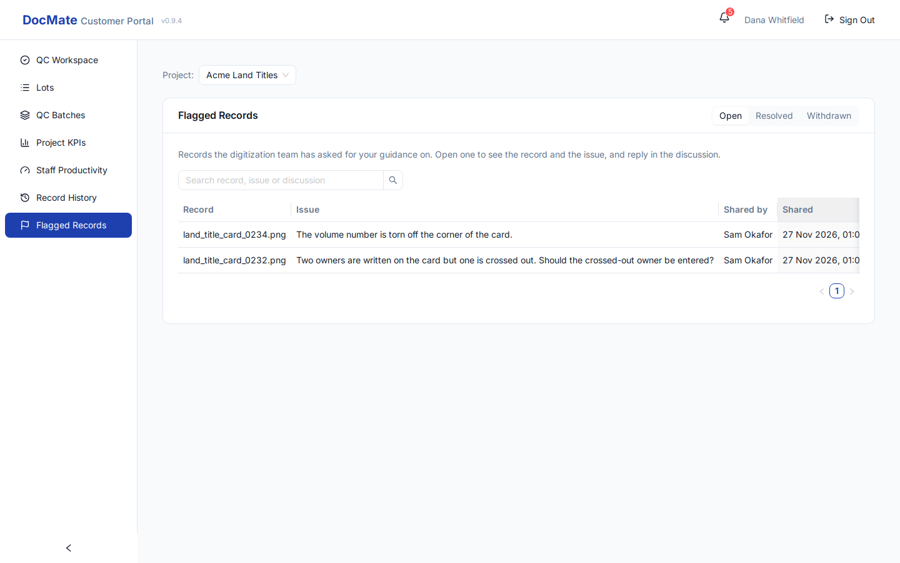

The **Messages** column counts the posts in each discussion.

**Finding a flag.** Type in the search box above the list to find flags by record name, identifier or number, by batch, by the team's question, by the resolution, or by anything said in the discussion. The list narrows as you type, and the count beside the box says how many flags match in the tab you're on. To search resolved or withdrawn flags, switch tab first. Clear the box to see every flag again.

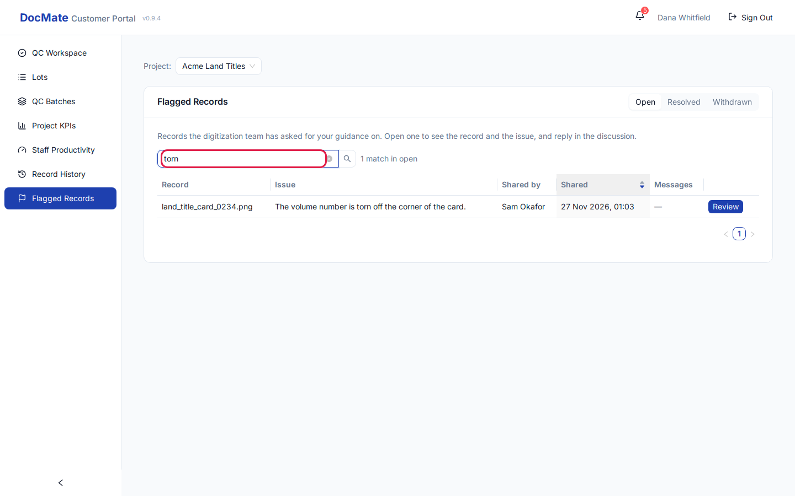

**Step 2.** Click **Review** on a flag.

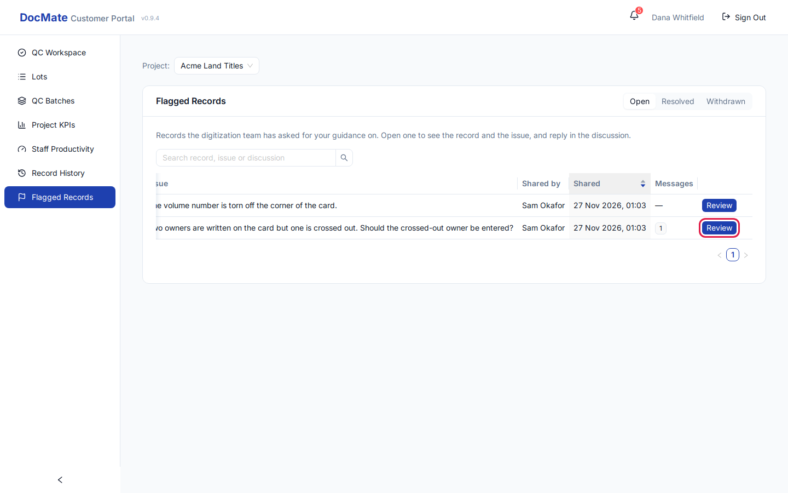

**Step 3.** The panel shows:
- the team's question, in the yellow box;
- the discussion so far;
- the record's image and indexed data, further down. You can zoom and rotate the image as in the QC Workspace.

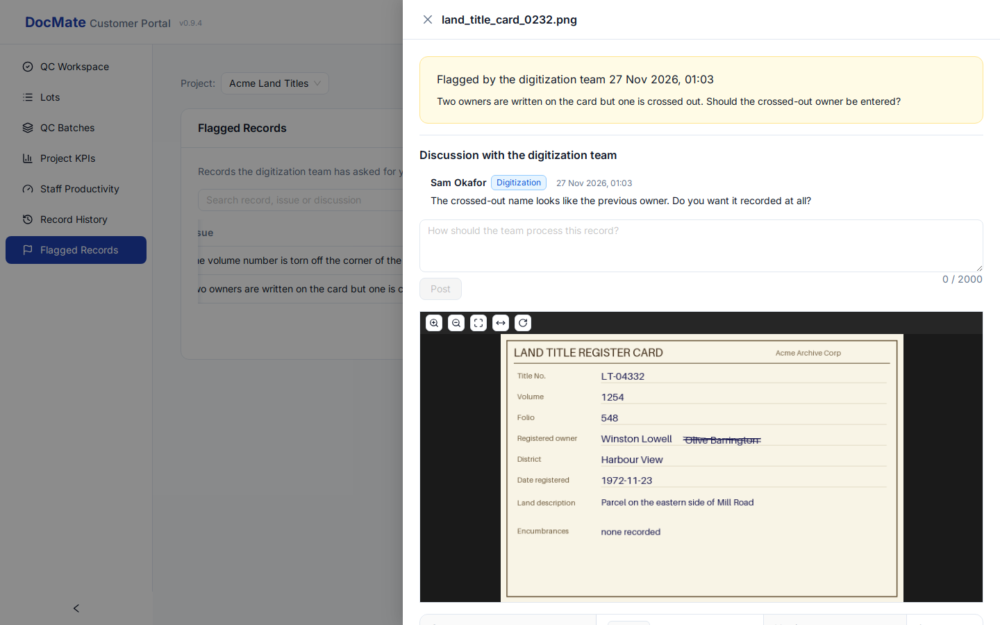

**Step 4.** Type your guidance in the box, saying how the team should process the record, and click **Post**.

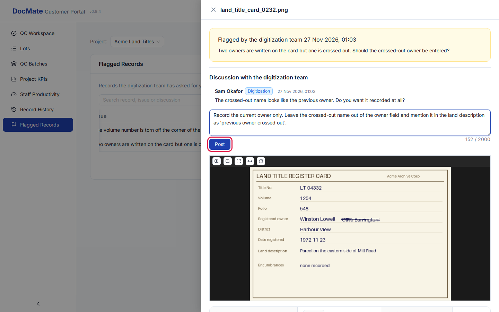

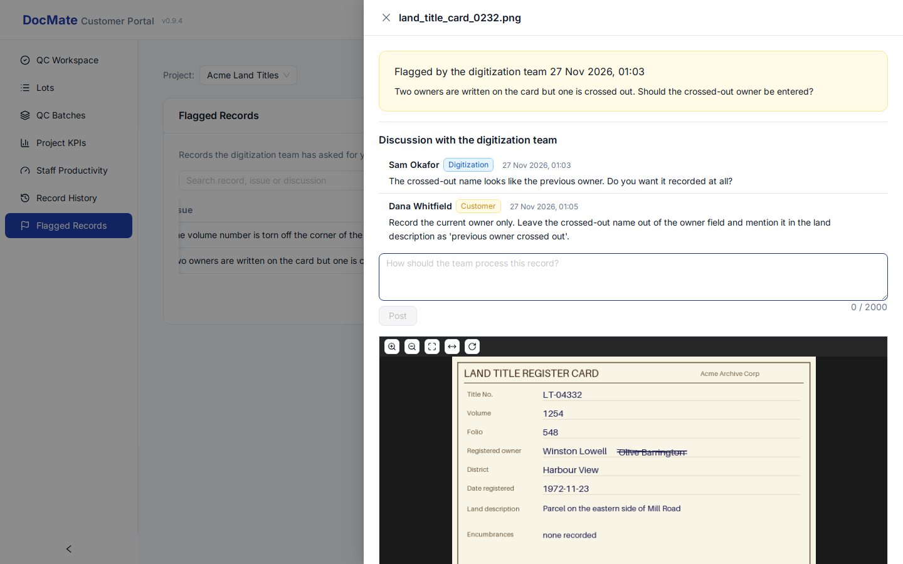

Your message appears straight away, and the team's supervisors are notified. They can reply in turn. When they've acted on it, they **resolve** the flag and record what was done.

**Resolved and Withdrawn flags.** Use the tabs at the top right:
- **Resolved** lists flags the team has closed, with their resolution.
- **Withdrawn** lists flags the indexer removed themselves, for example because they found the answer.

Click **View** to read the whole exchange.

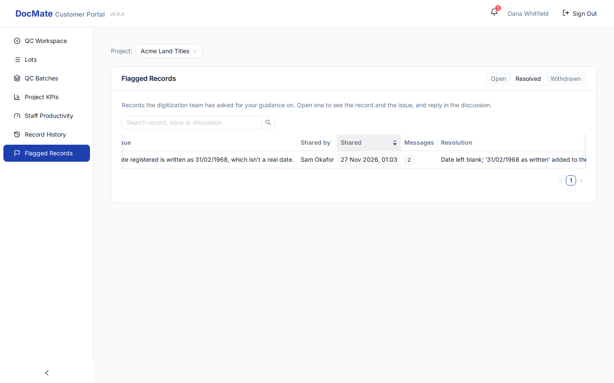

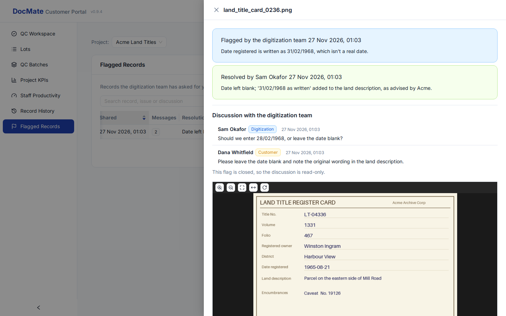

> You can only post on **open** flags that have been shared with you. Only the digitization team can resolve a flag. If they stop sharing a flag, it disappears from your list.

---

## 14. Notifications

The bell in the header shows how many unread notifications you have.

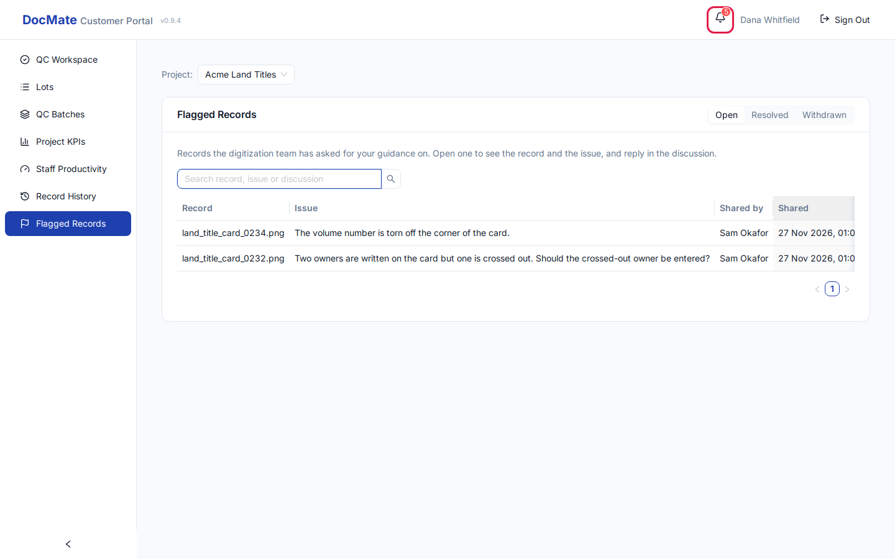

You're notified when the digitization team:
- shares a flagged record with you;
- posts in a flag's discussion;
- resolves a shared flag;
- stops sharing a flag.

Click the bell to see your latest notifications. Unread ones are highlighted.
- Click a notification to go straight to that flag.
- Click **Mark all read** to clear the count.

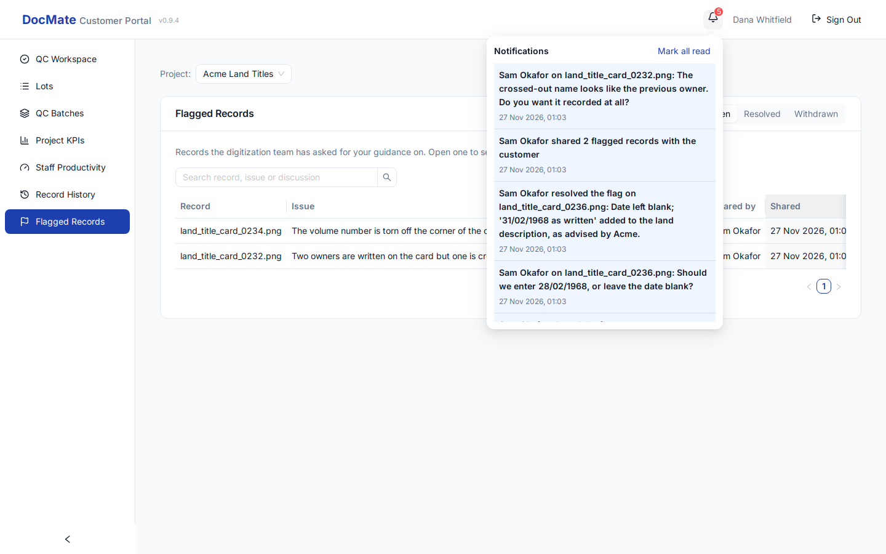

The bell checks for new notifications every 30 seconds.

---

## 15. Project KPIs

Click **Project KPIs** and choose a project to see how the work is going.

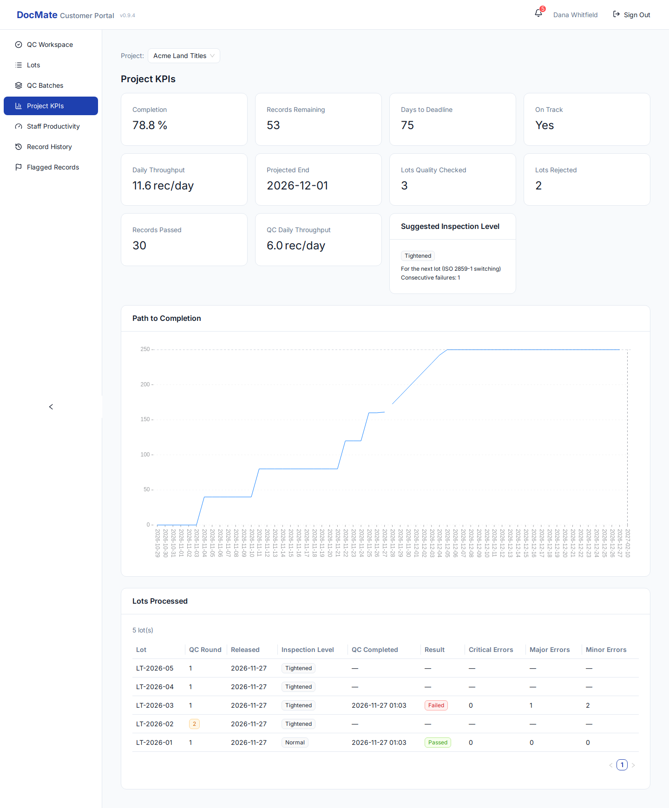

| Figure | Meaning |
|---|---|
| **Completion** | The share of the project's records that the digitization team has finished |
| **Records Remaining** | Records not yet finished |
| **Days to Deadline** | Days left until the project's agreed end date |
| **On Track** | **Yes** if, at the current rate, the work will finish by the deadline |
| **Daily Throughput** | Records the team finished per day, averaged over the last 7 days |
| **Projected End** | When the work will finish at the current rate |
| **Lots Quality Checked** | QC rounds your organisation has completed. A lot that failed and was checked again counts twice. |
| **Lots Rejected** | QC rounds that failed |
| **Records Passed** | Sampled records your reviewers passed |
| **QC Daily Throughput** | Records your reviewers checked per day |
| **Suggested Inspection Level** | The level the switching rules suggest for the next lot, and the current run of failed lots ([Section 7](#7-lot-settings-and-the-aql-configuration)) |

- **Path to Completion** plots records finished over time. The dashed line marks the deadline.
- **Lots Processed** lists every lot released to you, with:
  - its QC round (rounds after the first are highlighted);
  - its release date;
  - its inspection level;
  - when QC finished;
  - the result;
  - its critical, major and minor errors.

The page refreshes every minute.

---

## 16. Staff Productivity

Click **Staff Productivity** to see what each of your reviewers has done. Choose a date with the date picker; it starts on today.

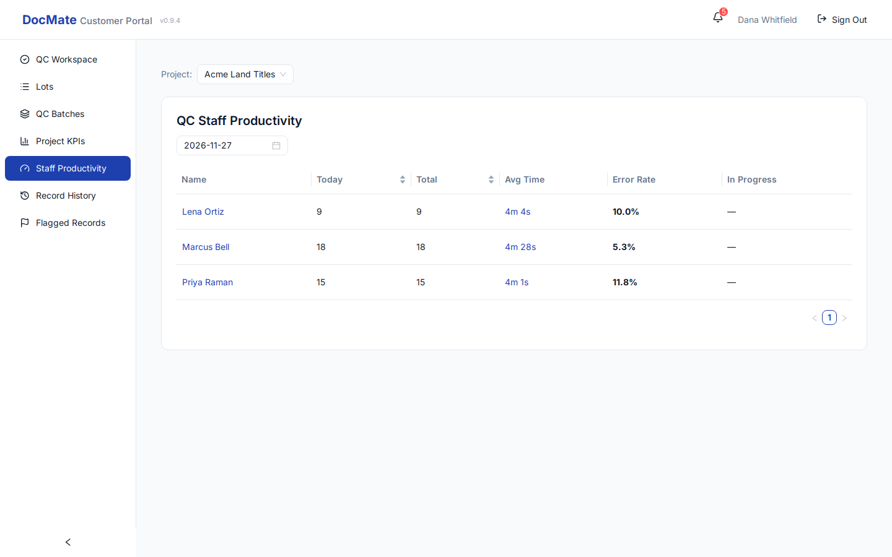

| Column | Meaning |
|---|---|
| **Today** | Records the reviewer finished on the chosen date |
| **Total** | Records the reviewer has finished on this project |
| **Avg Time** | The average time spent on each record |
| **Error Rate** | The share of the reviewer's records that they rejected |
| **In Progress** | Records the reviewer has open right now |

**How time is counted.** DocMate counts only the time a reviewer is actually working on a record: the record is open, the window is in front, and they've clicked, typed or scrolled in the last few minutes. If they leave a record and come back to it later, the two sittings are added together; the time in between isn't counted. Records reviewed before version 0.9.3 were timed from the last time they were opened to when they were finished.

### Time per record

**Step 1.** Click a reviewer's name, or their **Avg Time**, to see every record behind the figures.

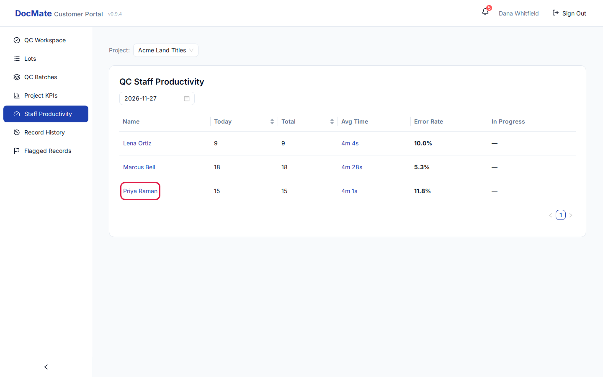

**Step 2.** The panel lists each record they reviewed, with its batch, when they started and finished it, the **time** spent, the number of **sessions** (sittings) it took, and the **outcome** (**Passed** or **Rejected**). Above the list are the totals: records finished, total time, average, median, fastest and slowest, and how many records were **reopened** (took more than one session).

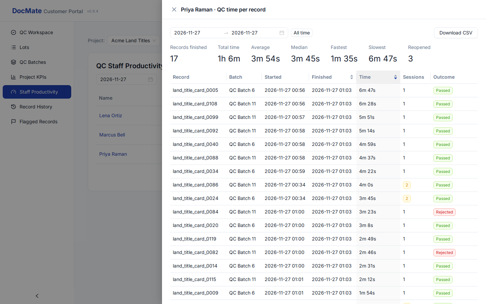

- The dates at the top start on the day chosen on the report. Change them to look at a longer period, or click **All time**.
- Click the **Time** or **Finished** column heading to sort by it.
- Click **Download CSV** to get the list as a spreadsheet.

> A high error rate isn't necessarily a problem. It may simply mean the reviewer got a weak part of a lot. Compare reviewers over several lots before drawing conclusions.

---

## 17. Record History

**Record History** shows the complete, unchangeable audit trail of any record: who created, indexed, checked, rejected and corrected it, and when.

**Step 1.** Click **Record History** and choose the project.

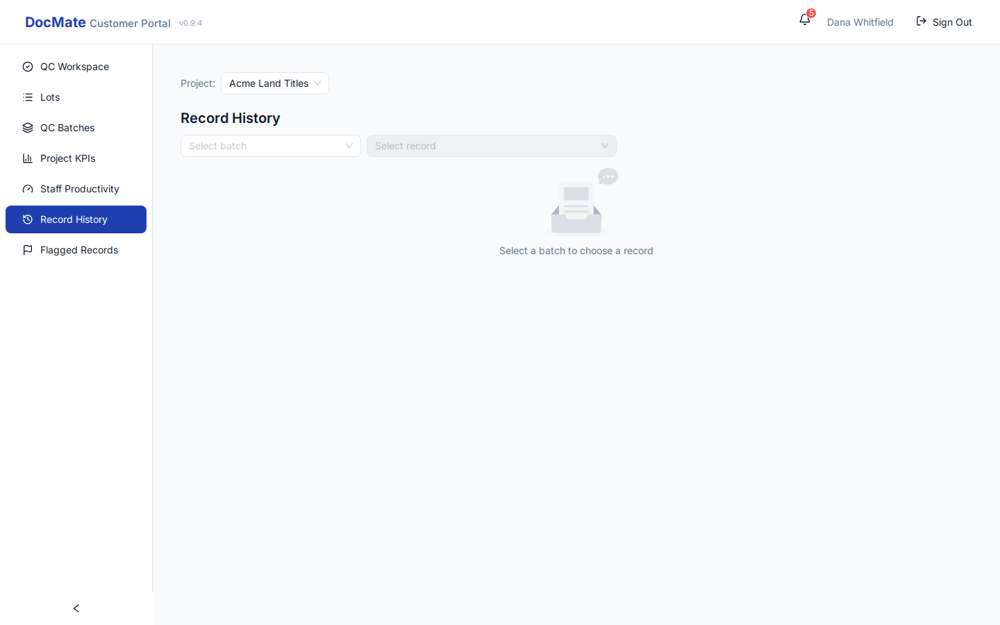

**Step 2.** Choose a **batch**. Records that customer QC rejected are moved to their own **QC Rework** batch while they're being corrected, which makes them easy to find.

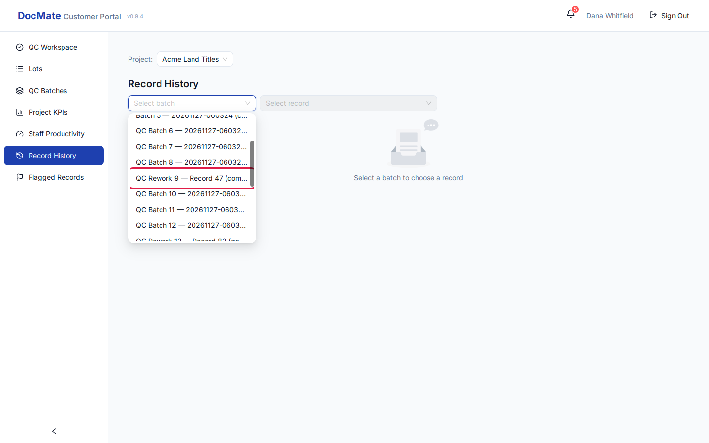

**Step 3.** Choose a **record**. You can type part of its name or number to search.

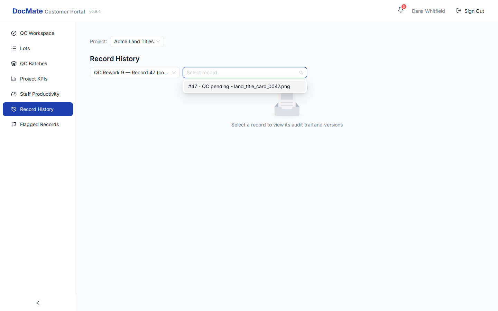

**Step 4.** The **Audit Timeline** tab lists every event in order, with who did it and when. Some events also show the details recorded with them.

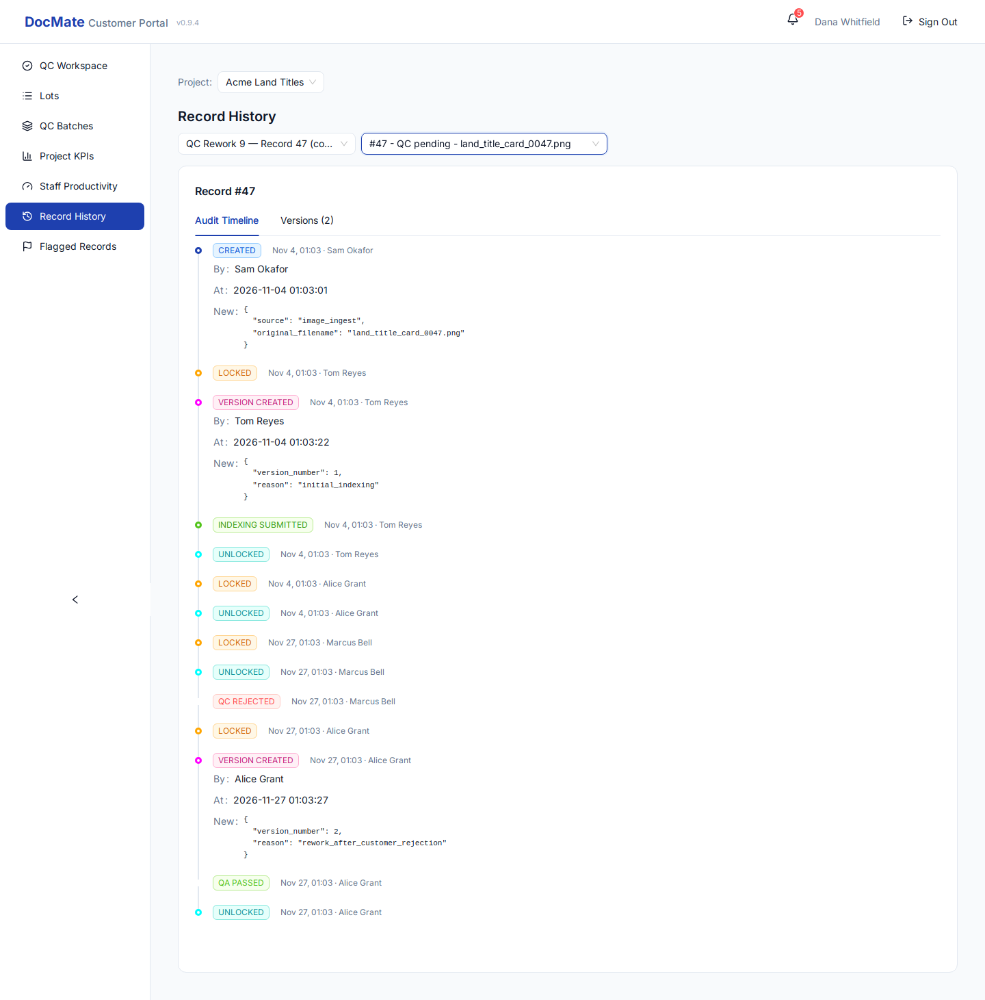

The example record shows its whole journey:
1. created;
2. indexed by the team (*Indexing submitted*);
3. passed by their QA;
4. **rejected** by Acme's reviewer Marcus Bell (*QC rejected*);
5. corrected by the team's QA (*Version created: rework_after_customer_rejection*);
6. passed again.

**Step 5.** The **Versions** tab shows each saved version of the record's data in full, with the reason it was saved:
- *initial_indexing*: the first version.
- *correction*: the indexer fixed their own entry before the batch was finished.
- *rework_after_qa*: re-entered after the team's own QA rejected it.
- *rework_after_customer_rejection*: corrected after your reviewers rejected it.
- *supervisor_requeue*: sent back by the team's supervisor.

Compare versions to see exactly what changed. In the example, the correction changed the registered owner from *Rupert Hollis* to *Rupert Barrington*.

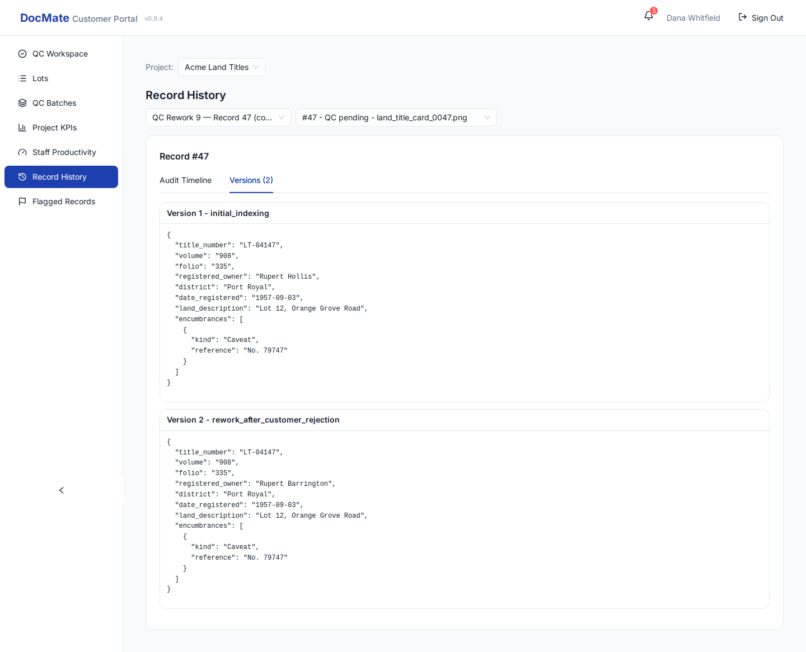

---

## 18. Signing out

**Step 1.** Click **Sign Out** at the top right.


**Step 2.** You're returned to the sign-in page. It's now safe to close the browser.


> Always sign out on a shared computer. Closing the tab alone may leave you signed in.

---

## 19. Troubleshooting

| What you see | What to do |
|---|---|
| **"Unknown Portal"** when opening the portal | Check the address. The first part must be your organisation's portal name, for example `acme-archive`. |
| **"Failed to connect to the authentication service"** | DocMate's sign-in service can't be reached. Try again in a few minutes, then contact your administrator. |
| **"Invalid username or password"** | Retype your password, checking Caps Lock. Ask your administrator to reset it if needed. |
| **"You need to change your password to activate your account"** | You signed in with a temporary password. Choose your own ([Section 3](#3-signing-in)). |
| **"Select a project above to continue"** | Choose a project in the **Project** box at the top of the page. |
| **"No lots released to your organisation yet"** | The digitization team hasn't released a lot on this project yet. |
| **Assign to QC is greyed out** | Apply a sample first ([Section 8](#8-applying-the-sample)). |
| **A reviewer is missing from the Assign to list** | Only active reviewers and supervisors from your organisation are listed. Ask your administrator. |
| **The lot stays QC In Progress** | Some sampled records haven't been reviewed yet. Open **Assign to QC**: the form's title shows how many are still unassigned, and **Sampled records** shows each record's review status. Assign the rest, or check with whoever holds them. |
| **A reviewer is away with records still open** | Reassign their batch on the **QC Batches** page ([Section 9](#reassigning-a-batch)). |
| **Reassign is greyed out** | Every record in that batch has already been reviewed, so there's nothing to move. |
| **A search on Flagged Records finds nothing** | The search covers only the tab you're on. Try the **Resolved** or **Withdrawn** tab, or a shorter search. |
| **You're asked to sign in again** | Your session ended after a period of inactivity. Sign in again; saved work is kept. |

---

## 20. Glossary

| Term | Meaning |
|---|---|
| **Acceptance number (Ac)** | The most defects of one class a sample can contain and still pass. Each class has its own (ISO projects). |
| **AQL** | *Acceptable Quality Level.* A quality requirement, set for each defect class. With the lot size and inspection level, it decides the sample size and acceptance number. Lower is stricter. |
| **Batch (QC batch)** | A group of sampled records assigned to one person as a unit of work |
| **Classification agreement** | The project's rule for whether each kind of error (missing data, typographic, interpretation) counts as major or minor |
| **Defect class** | Critical, major or minor: how serious a defect is. Each class has its own AQL and acceptance number. |
| **Error type** | What was wrong with a defective field: **Missing** data, a **Typo**, or an **Interpretation** error |
| **Customer QC** | Your organisation's independent quality check of the digitization team's work |
| **General inspection level** | I, II or III. The ISO 2859‑1 setting that makes samples smaller (I) or larger (III) than the standard (II). |
| **Flag** | A question an indexer raises about a record they can't index with confidence |
| **Identifier field** | A field that identifies the record, such as the title number. Any error in it is a critical defect. |
| **Indexed data** | The information typed up from a record's image |
| **ISO 2859‑1** | The international standard for sampling inspection that DocMate follows |
| **Lot** | A group of records the digitization team hands over together for QC |
| **Non-conformity** | One defective field. Non-conformities are counted per class. |
| **Outgoing inspection** | The digitization team's own sampling inspection, carried out before releasing a lot to you |
| **QC round** | One pass of customer QC over a lot. A resubmitted lot starts a new round. |
| **Reassign** | Moving a QC batch's open records to another person |
| **Rejection number (Re)** | The number of defects of one class that fails the lot (ISO projects) |
| **Remediation** | Sending a failed lot back to the digitization team to correct the rejected records |
| **Sample** | The records picked at random from a lot for your reviewers to check |
| **Inspection level** | Normal, Tightened or Reduced. Set for each lot by the digitization team's supervisor, usually following the level DocMate suggests from recent lot results. |
| **Suggested level** | The inspection level ISO 2859‑1's switching rules recommend for the next lot |
| **Version** | A saved copy of a record's data, made whenever the data is indexed or corrected |
